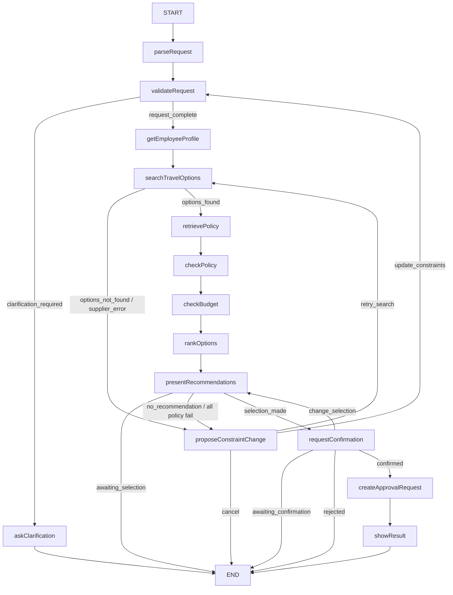

# Travel Policy Copilot (MVP)

Travel Policy Copilot — агент на базе LangGraph для планирования корпоративных поездок: извлекает параметры из текста пользователя, ищет варианты, проверяет корпоративные политики, ранжирует предложения и создаёт черновик заявки только после явного подтверждения человеком.

## 1) Цель MVP

- Преобразовать свободный запрос о командировке в структурированный `TripRequest`.
- Показать объяснимые рекомендации с цитатами из корпоративных политик.
- Гарантировать, что заявки не сохраняются без явного подтверждения.
- Обеспечить измеримую оценку качества: эталонный прогон, набор оценочных тестов и трассировку в Langfuse.

## 2) Что реализовано

- Рабочий процесс с сохранением состояния в LangGraph (прерывание и продолжение, идентификатор потока, контрольные точки).
- Шлюз к языковой модели через `router.ai` (совместим с OpenAI API) с учётом использования и стоимости.
- Интеграции: репозитории PostgreSQL, имитация Travel API, загрузка и поиск по политикам (Qdrant).
- Проверка соответствия политикам и удобства: класс обслуживания, отель, бюджет, исключения.
- Эталонный прогон (20 сценариев), тесты безопасности, оценка качества ответов моделью и метрики поиска по политикам.
- Интеграционные тесты в `tests/integration`, запуск через `scripts/run_integration_tests.py`.
- Контроль доступа и проверка выбранного варианта перед записью в базу; журнал аудита.
- Среда Docker: миграции, загрузка сотрудников и автоматическая индексация политик в Qdrant.
- HTTP API агента с сохранением состояния (`/sessions`, `/actions`) и интерфейс, работающий только через API.
- Внешний провайдер векторных представлений RouterAI (`baai/bge-m3`, размерность `1024`) в режиме `strict`.

## 3) Архитектура

- `src/agent` — граф, узлы, состояние, ограничения выполнения, API продолжения сессии.
- `src/llm` — шлюз к провайдеру, структурированный ответ модели, сбор статистики использования.
- `src/persistence` — адаптеры PostgreSQL и резервный репозиторий.
- `src/mock_travel_api` — сервис FastAPI с вариантами поездок и сценариями ошибок.
- `src/rag` — загрузка документов, поиск, оценка качества, очистка контекста.
- `src/policy` — детерминированные правила и оценка рекомендаций.
- `src/api` — HTTP-конечные точки с сохранением состояния (создание и чтение сессии, действия).
- `src/api/session_store.py` — хранение сессий в памяти процесса.
- `src/ui` — интерфейс Streamlit, обращается только к API.
- `src/observability` — трассировка и оценки в Langfuse.
- `scripts` — запуск эталонного прогона, оценочных тестов и интеграционных проверок.

## 4) Схема работы LangGraph



Основные ветвления:

- **Уточнение** — запрос неполный → узел `ask_clarification`.
- **Варианты найдены / не найдены** — мок-сервис Travel API вернул предложения или пустой результат.
- **Ошибка поставщика** — временная или постоянная ошибка внешнего сервиса → узел `propose_constraint_change`.
- **Все варианты нарушают политику** → `no_recommendation` → предложение изменить ограничения.
- **Выбор → подтверждение → запись** — перед записью в PostgreSQL требуется подтверждение пользователя.

## 5) Действия API

Типы действий (`AgentActionType` в `src/api/schemas.py`):

| Действие | Когда доступно |
|---|---|
| `submit_clarification` | `ask_clarification` |
| `update_constraints` | `propose_constraint_change` |
| `retry_search` | `propose_constraint_change` |
| `cancel` | `propose_constraint_change` |
| `select_option` | `present_recommendations` |
| `confirm` | `request_confirmation` |
| `reject` | `request_confirmation` |
| `change_selection` | `request_confirmation` |

## 6) Режимы backend

| Режим | Поведение |
|---|---|
| `strict` | Только PostgreSQL, HTTP Mock Travel API, RouterAI (модель и векторные представления) и Qdrant; резервные заглушки запрещены. |
| `demo_fallback` | При недоступности внешних сервисов включается упрощённый демонстрационный режим. |
| `test` | Для модульных и интеграционных тестов допустимы локальные заглушки и упрощённые векторные представления. |

В режиме `strict` для векторного поиска используется RouterAI, модель `baai/bge-m3`, размерность `1024`.

## 7) Запуск

### Docker Compose

```bash
cp .env.example .env
# заполнить: LLM_API_KEY, EMBEDDING_API_KEY, LANGFUSE_PUBLIC_KEY, LANGFUSE_SECRET_KEY
docker compose up -d --build
```

`docker compose` поднимает одноразовый сервис `bootstrap`, который:

- применяет SQL-миграции (`migrations/*.sql`);
- загружает `data/employees/seed_employees.json` в PostgreSQL;
- индексирует политики в Qdrant перед запуском `api` и `ui`.

Адреса сервисов:

- UI: `http://localhost:8501`
- Документация API: `http://localhost:8000/docs`
- Langfuse: `http://localhost:3000`
- Mock Travel API: `http://localhost:8081`

### Локально (для разработки)

Нужны отдельно запущенные PostgreSQL, Qdrant и Mock Travel API; начальная настройка и индексация выполняются вручную. Для воспроизводимой демонстрации удобнее Docker Compose.

```bash
cp .env.example .env
./.venv/bin/python -m pip install -r requirements.txt
./.venv/bin/python scripts/bootstrap_runtime.py
./.venv/bin/python -m uvicorn src.mock_travel_api.main:app --host 0.0.0.0 --port 8081
./.venv/bin/python -m uvicorn src.api.main:app --host 0.0.0.0 --port 8000
./.venv/bin/streamlit run src/ui/app.py
```

API с сохранением состояния:

- `POST /v1/agent/sessions` — начало новой сессии.
- `GET /v1/agent/sessions/{session_id}?employee_id=...` — чтение состояния с проверкой доступа.
- `POST /v1/agent/sessions/{session_id}/actions` — продолжение диалога (см. раздел 5).

## 8) Демонстрационный сценарий

1. Открыть UI (`http://localhost:8501`), выбрать сотрудника.
2. Ввести запрос о поездке на естественном языке.
3. Ответить на уточняющие вопросы (если потребуются).
4. Получить ранжированные рекомендации с проверкой политик и бюджета, со ссылками на источники.
5. Выбрать вариант и подтвердить создание заявки.
6. Получить `approval_request_id` из PostgreSQL.
7. Трассировку можно посмотреть в Langfuse по `trace_id` из ответа API.

## 9) Тесты и оценка качества

```bash
./.venv/bin/python -m pytest -q
./.venv/bin/python scripts/run_docker_smoke.py
./.venv/bin/python scripts/run_evals.py   # эталонный прогон + оценка RAG + оценка ответов моделью
```

Отчёты сохраняются в:

- `data/benchmark/last_report.json`
- `data/evals/last_eval_report.json`

## 10) Известные ограничения

- **Сессии в памяти** — хранилище сессий не переживает перезапуск API; для промышленной эксплуатации нужен Redis или база данных.
- **Небольшой корпус политик** — поиск по документам (RAG) включён для учебного опыта; для такого объёма данных проще было бы передавать полный текст политик в контекст модели.
- **Режим `test`** с упрощёнными векторными представлениями не подтверждает качество RAG в режиме `strict`.
- **Упрощённая авторизация** — роль согласующего реализована минимально.
- Оценки от модели-судьи публикуются как Langfuse Scores, а не через интерфейс Evaluators.
