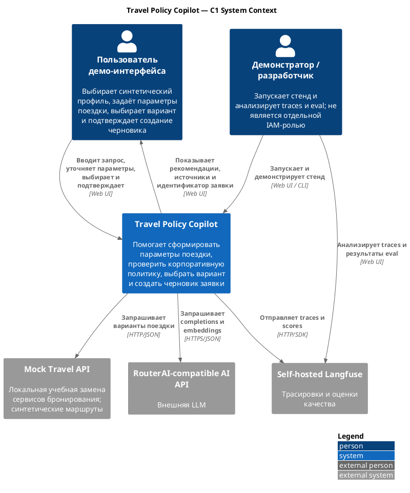

# Проблема, контекст и границы Travel Policy Copilot

**Проект:** Travel Policy Copilot  
**Целевая система:** Travel AI Platform  
**Тип документа:** контекст и границы архитектуры  


---

## 1. Назначение документа

Документ определяет:

- бизнес-проблему и ожидаемую ценность решения;
- место Travel Policy Copilot в более широкой инициативе Travel AI Platform;
- объект архитектурного проектирования;
- пользователей и заинтересованные стороны;
- основной пользовательский сценарий;
- внешние системы и организационный контекст;
- границы реализованного MVP;
- осознанно исключённые возможности;
- соответствие целевых корпоративных компонентов их учебным заменам;
- ограничения достоверности и пробелы runtime evidence.

Документ не описывает детальную внутреннюю архитектуру, API, модель данных, безопасность и deployment. Они рассматриваются в последующих разделах архитектурного репозитория. Здесь фиксируется контекст, необходимый для правильного прочтения этих артефактов.

---

## 2. Правила интерпретации статусов

| Статус                       | Значение                                                                                      |
| ---------------------------- | --------------------------------------------------------------------------------------------- |
| **Context**                  | Бизнес- и организационный контекст, принятый как легенда проекта                              |
| **As-Is**                    | Наличие возможности подтверждено статическим анализом baseline                                |
| **As-Is runtime-unverified** | Реализация обнаружена в исходном коде или конфигурации, но её работа не подтверждена запуском |
| **Partial**                  | Возможность реализована не полностью либо подтверждена только частично                        |
| **Target / Pilot**           | Предлагается для следующего этапа развития, но не считается реализованным                     |
| **Deferred**                 | Осознанно отложено за пределы текущего проекта                                                |
| **Gap**                      | Выявленное расхождение между требуемым и фактическим состоянием                               |
| **Open**                     | Требуется решение или уточнение                                                               |

---

## 3. Краткое описание решения

**Travel Policy Copilot** — AI-помощник для планирования корпоративных командировок, проверки корпоративных правил и формирования черновика заявки на согласование.

Пользователь описывает предполагаемую поездку на естественном языке. Решение должно помочь собрать необходимые параметры, получить варианты поездки, найти применимые нормативы, выполнить формальные проверки, объяснить рекомендации и после явного подтверждения пользователя создать черновик заявки.

Travel Policy Copilot рассматривается одновременно как:

1. самостоятельный учебный AI-продукт с работающим пользовательским сценарием;
2. вертикальный срез интеллектуального ядра целевой Travel AI Platform;
3. объект полноценного архитектурного проектирования в рамках дипломной работы курса «Архитектор ИИ».

При этом архитектурная работа не ставит целью спроектировать всю Travel AI Platform. Платформа используется для объяснения бизнес-контекста, внешних интеграций и направления дальнейшего развития Copilot.

---

## 4. Бизнес-контекст

### 4.1. Условный заказчик

В качестве бизнес-контекста рассматривается крупный федеральный ритейлер с территориально распределённой структурой:

- центральный офис;
- региональные подразделения;
- магазины;
- склады;
- логистические центры.

Сотрудники организации регулярно совершают командировки между территориально распределёнными объектами. Процесс частично автоматизирован, но остаётся фрагментированным и требует ручного участия сотрудника, руководителя, административных и финансовых подразделений.

Контекст является учебной легендой проекта. Реальные данные конкретной организации и реальные интеграции в MVP не используются.

### 4.2. Текущее состояние процесса

Для исходного процесса характерны следующие особенности:

- сотрудник самостоятельно ищет и сравнивает билеты и гостиницы;
- правила командировок распределены по регламентам, приказам и локальным документам;
- лимиты зависят от категории сотрудника, направления, типа услуги и других условий;
- корпоративные договоры и ограничения учитываются не всегда;
- соответствие бюджету и политике нередко проверяется вручную;
- нарушение правил может обнаружиться после выбора варианта;
- причины рекомендации или отклонения недостаточно прозрачны;
- данные о выборе и результатах поездок слабо используются для улучшения процесса.

### 4.3. Бизнес-запрос

Исходный бизнес-запрос можно сформулировать следующим образом:

> Создать удобный сервис планирования корпоративных командировок, который помогает сотруднику подобрать подходящие варианты, учитывает корпоративные правила и бюджет, объясняет рекомендации и помогает сформировать заявку на согласование.

Этот запрос намеренно шире реализованного дипломного MVP. Граница между целевым сервисом и Travel Policy Copilot фиксируется далее.

---

## 5. Проблема

### 5.1. Основная проблема

Сотруднику приходится вручную объединять сведения из нескольких источников: требования поездки, доступные варианты, профиль и лимиты сотрудника, корпоративную политику и требования согласования. Это повышает длительность оформления командировки, вероятность нарушения правил и нагрузку на проверяющие подразделения.

### 5.2. Наблюдаемые последствия

- избыточное время на поиск и сравнение вариантов;
- выбор более дорогих или неподходящих предложений;
- нарушения корпоративной политики;
- возврат заявок на доработку;
- задержки согласования;
- высокая нагрузка на административные и финансовые подразделения;
- недостаточная объяснимость выбора;
- сложность актуализации правил в пользовательском процессе.

### 5.3. Причины, на устранение которых направлено решение

| Причина                                             | Как на неё отвечает Copilot                            |
| --------------------------------------------------- | ------------------------------------------------------ |
| Неструктурированный запрос сотрудника               | Диалог и извлечение параметров из естественного языка  |
| Разрозненные нормативы                              | RAG по корпоративным документам с указанием источников |
| Формализуемые лимиты и запреты                      | Детерминированный Policy Engine и проверка бюджета     |
| Большое количество вариантов                        | Фильтрация и прозрачное ранжирование                   |
| Риск непрозрачного AI-решения                       | Объяснение, rule IDs, источники и trace                |
| Риск ошибочного действия                            | Human-in-the-Loop перед write-операцией                |
| Недоступность реальных интеграций в учебном проекте | Mock-сервисы за стабильными контрактами                |

---

## 6. Цель и ожидаемая ценность

### 6.1. Цель Travel Policy Copilot

Предоставить сотруднику управляемый диалоговый сценарий, который помогает сформировать требования к командировке, получить и сравнить варианты, проверить ограничения, увидеть нормативное обоснование и сформировать черновик заявки после явного подтверждения.

### 6.2. Пользовательская ценность

- единая точка взаимодействия вместо ручной работы с несколькими источниками;
- сокращение числа пропущенных параметров заявки;
- раннее выявление превышений лимитов и нарушений политики;
- объяснимые рекомендации;
- ссылка на применённые нормативные положения;
- снижение вероятности повторного оформления заявки;
- сохранение контроля человека над значимым действием.

### 6.3. Ценность для организации

- потенциальное сокращение времени оформления командировки;
- снижение нагрузки на административный и финансовый контроль;
- уменьшение доли заявок с нарушениями;
- повышение прозрачности и аудируемости;
- создание основы для последующей интеграции с HR, ERP, BPM и поставщиками;
- накопление данных для будущего улучшения рекомендаций.

### 6.4. Ограничение утверждений о ценности

В рамках учебного MVP ценность является архитектурной гипотезой. Проект не доказывает фактический ROI, сокращение стоимости поездки или изменение производственных показателей реальной организации.

Допустимо подтверждать:

- работоспособность сценария;
- корректность прохождения предусмотренных ветвей;
- наличие нормативных источников;
- измеренные технические и AI-метрики;
- возможность заменить mock-компоненты реальными интеграциями при сохранении контрактов.

Недопустимо выдавать синтетические данные и результаты учебного тестирования за доказанный бизнес-эффект.

---

## 7. Объект архитектурного проектирования

### 7.1. Основной объект

Основным объектом архитектурного проектирования является **Travel Policy Copilot MVP**.

В архитектурном репозитории подробно рассматриваются:

- пользовательская граница Copilot;
- Agent/API и агентная оркестрация;
- RAG по корпоративной политике;
- детерминированные проверки политики и бюджета;
- получение вариантов поездки;
- формирование рекомендаций;
- Human-in-the-Loop;
- создание черновика заявки;
- операционные данные и состояние;
- наблюдаемость и оценка качества;
- безопасность;
- локальное развёртывание;
- путь эволюции к Pilot.

### 7.2. Целевой контекст

**Travel AI Platform** является целевой инициативой верхнего уровня. Она объясняет:

- откуда в целевом окружении должны поступать профили сотрудников;
- откуда должны поступать предложения билетов и гостиниц;
- где находятся бюджеты и корпоративные правила;
- куда должна передаваться заявка на согласование;
- где в перспективе выполняются бронирование, уведомления и сбор обратной связи.

Для Travel AI Platform в рамках диплома создаются только:

- одна C1/context diagram;
- описание внешних систем и заинтересованных сторон;
- граница дипломного объема работ;
- таблица `Target → MVP replacement`;
- краткое направление развития `MVP → Pilot → Target`.

Полная C2/C3, ER-модель, deployment architecture и пакет ADR всей платформы не создаются.

### 7.3. Архитектурный тезис

> Travel Policy Copilot — реализованный учебный MVP и вертикальный срез интеллектуального ядра Travel AI Platform. Производственные системы, недоступные в учебном проекте, заменены контролируемыми реализациями за контрактами, допускающими дальнейшую замену.

---

## 8. Пользователи и заинтересованные стороны

### 8.1. Пользовательские роли MVP

| Роль                                 | Потребность                            | Предусмотренные действия                                                                                                        | Текущий статус                                                                              |
| ------------------------------------ | -------------------------------------- | ------------------------------------------------------------------------------------------------------------------------------- | ------------------------------------------------------------------------------------------- |
| **Сотрудник / пользователь demo UI** | Спланировать поездку в рамках правил   | Выбрать синтетический employee ID, ввести запрос, уточнить параметры, выбрать вариант, подтвердить/отклонить создание черновика | **Реализовано**, но нет аутентификации:                                                     |
| **Демонстратор**                     | Настроить и продемонстрировать систему | Выбрать тестовый профиль, открыть debug-панель с trace/session/current node; benchmark/eval запускаются отдельными scripts      | **Частично реализовано**: функции демонстрации есть, отдельной admin-роли и авторизации нет |

Фактическая аутентификации отсутствует: `employee_id` передаётся клиентом. 

### 8.2. Заинтересованные стороны целевого решения

| Заинтересованная сторона | Интерес / зона ответственности |
|---|---|
| Бизнес-заказчик | Ценность, применимость и развитие решения |
| Сотрудники | Удобство, точность и прозрачность рекомендаций |
| Руководители и согласующие | Корректность заявки и обоснование отклонений |
| Административное подразделение | Соблюдение процесса командировок |
| Финансовый контроль | Бюджеты, лимиты и аудируемость |
| HR | Профиль, категория и организационная принадлежность сотрудника |
| Служба безопасности | Защита данных и контроль AI-рисков |
| Архитектурный комитет / CTO | Согласованность, интегрируемость и эволюционность |
| Владельцы HR/ERP/BPM/IAM | Контракты и ответственность за мастер-данные |
| Эксплуатация | Развёртывание, наблюдаемость и восстановление |
| Поставщики travel-услуг | Поиск, бронирование, отмены и статусы |

Не все заинтересованные стороны являются пользователями MVP. Таблица отражает Target-контекст.

---

## 9. Основной пользовательский сценарий

### 9.1. Исходный запрос

Пример:

> Мне нужно 18 сентября утром попасть из Казани в Санкт-Петербург на встречу к 15:00. Вернуться на следующий день. Ночной вылет не подходит.

### 9.2. Фактический сценарий реализации

1. Пользователь выбирает один из пяти синтетических профилей сотрудника.
2. Вводит запрос естественным языком.
3. Copilot извлекает структурированные параметры поездки.
4. Проверяет полноту параметров и при необходимости задаёт уточняющий вопрос.
5. Получает профиль выбранного сотрудника.
6. Запрашивает варианты поездки у Mock Travel API.
7. Извлекает применимые положения корпоративной политики через RAG.
8. Выполняет детерминированные проверки политики и бюджета.
9. Ранжирует варианты и показывает список, рекомендацию, объяснение и нормативные источники.
10. Пользователь выбирает вариант.
11. Copilot запрашивает явное подтверждение создания черновика.
12. После подтверждения создаёт идемпотентный черновик заявки в PostgreSQL.
13. Пользователь получает идентификатор заявки.


### 9.4. Альтернативные потоки, важные для границ

- неполный или неоднозначный запрос;
- отсутствие подходящих вариантов;
- превышение бюджета;
- нарушение правила или необходимость дополнительного согласования;
- отказ пользователя от подтверждения;
- ошибка внешнего сервиса;
- повторная попытка создания одной заявки;

---

## 10. Граница функционального объёма

### 10.1. Включено в MVP

Ниже перечислен функционал, который должен быть реализован:
- Диалоговый ввод требований к поездке;
- Извлечение и валидация параметров;
- Уточняющий диалог;
- Получение профиля сотрудника;
- Получение travel-предложений;
- RAG по корпоративным документам;
- Формальные проверки политики;
- Проверка бюджета;
- Ранжирование вариантов;
- Объяснение рекомендации;
- Human-in-the-Loop;
- Создание черновика заявки;
- Идемпотентность сохранения заявки;
- Trace/evaluation;
- Локальное контейнерное развёртывание;

### 10.2. Не включено в MVP

В текущий MVP не входят:

- реальные покупки и бронирования;
- реальные платёжные операции;
- автономное расходование средств;
- реальные travel API;
- реальные персональные данные;
- полноценное корпоративное SSO/IAM;
- полноценная интеграция с HR/ERP;
- полноценный BPM-процесс согласования;
- production-сервис бронирования;
- Kubernetes;
- HA/DR;
- production multi-tenancy;
- мобильное приложение;
- обучение собственной LLM;
- локальная LLM;
- полноценная обучаемая рекомендательная модель;
- Feature Store и training pipeline;
- multi-agent;
- MCP;
- GraphRAG/Knowledge Graph.

### 10.3. Осознанно отложенные возможности

| Возможность           | Причина исключения                            |
| --------------------- | --------------------------------------------- |
| HR/ERP/BPM/IAM        | Нет доступа к корпоративным системам          |
| Реальное бронирование | Финансовый и операционный риск                |
| ML recommender        | Нет репрезентативной истории выбора           |
| Multi-agent           | Не требуется для минимального сценария        |
| MCP                   | Не нужен для выполнения текущей задачи        |
| Локальная LLM         | Не является обязательным ограничением контура |
| Kubernetes/HA         | Избыточно для учебного стенда                 |

## 11. Системный контекст и внешние зависимости

### 11.1. Целевой контекст

В целевой корпоративной среде Copilot должен взаимодействовать со следующими классами систем:

- HR / Employee Profile — профиль, категория, подразделение;
- IAM/SSO — идентичность и права пользователя;
- ERP / Budget — бюджеты и финансовые ограничения;
- Supplier / Travel services — билеты, гостиницы и условия;
- Corporate Policy Repository — нормативные документы;
- BPM / Approval Workflow — создание и согласование заявки;
- Booking Service — бронирование после согласования;
- Notification Service — уведомления;
- Observability/SIEM — трассировка, аудит и события безопасности;
- LLM/AI services — генеративная модель, embeddings и при необходимости reranker.

Эти системы не входят в границу Travel Policy Copilot и не проектируются подробно.

### 11.2. Фактические внешние зависимости MVP

| Зависимость                                              | Назначение и данные                                                                                                   | Протокол / направление                                  |
| -------------------------------------------------------- | --------------------------------------------------------------------------------------------------------------------- | ------------------------------------------------------- |
| RouterAI-compatible LLM API                              | Структурированное извлечение, уточнение, объяснение; получает необходимые фрагменты пользовательского запроса/context | Исходящий HTTPS из Agent API                            |
| RouterAI-compatible embeddings API (`baai/bge-m3`, 1024) | Векторные представления фрагментов документов политик и извлечение данных                                             | Исходящий HTTPS из bootstrap/Agent API                  |
| `mock-travel-api`                                        | Синтетические предложения по параметрам поездки                                                                       | Внутренний HTTP `api → mock-travel-api:8081`            |
| PostgreSQL                                               | Синтетические профили пользователей и черновики подтвержденных заявок                                                 | PostgreSQL protocol `api/bootstrap → app-postgres:5432` |
| Qdrant                                                   | Индекс векторов политик и метаданные                                                                                  | HTTP/client `api/bootstrap → qdrant:6333`               |
| Langfuse                                                 | Workflow/tool/LLM/RAG трассировки и оценка качества                                                                   | SDK/HTTP `api/eval → langfuse-web:3000`                 |
| Хранилища для Langfuse                                   | PostgreSQL, ClickHouse, Redis, MinIO для самого Langfuse                                                              | Внутренние протоколы                                    |

---

## 12. Соответствие Target → MVP

Таблица связывает целевую платформу и дипломный MVP, не превращая платформу во второй объект детального проектирования.

| Целевой-компонент / функция     | Плановая замена в MVP                                 |
| ------------------------------- | ----------------------------------------------------- |
| Employee Profile Service        | PostgreSQL или локальный набор синтетических профилей |
| IAM/SSO                         | Выбор тестового сотрудника / trusted test context     |
| Supplier Integration Service    | Mock Travel API                                       |
| Recommendation Service          | Детерминированный scoring                             |
| Budget & Policy Rules Service   | Локальный Policy Engine                               |
| Corporate Knowledge Base        | Тестовые документы + Qdrant                           |
| Approval Workflow / BPM         | Локальное создание черновика заявки                   |
| Booking Service                 | Не реализуется                                        |
| Notification Service            | Не реализуется или упрощённый UI-result               |
| LLM Platform / Gateway          | Адаптер к внешней managed LLM                         |
| Production observability        | Langfuse и локальные logs                             |
| Kubernetes / production runtime | Docker Compose / локальный запуск                     |
| Feature Store / ML recommender  | Не реализуется                                        |

---

## 13. Контур развёртывания и доверия

### 13.1. Принятая модель MVP

Travel Copilot реализован как локально разворачиваемое приложение, имеющее сетевой доступ к внешней LLM. Следовательно, MVP не является air-gapped или полностью on-premise системой.

Это позволяет использовать внешнюю LLM при следующих ограничениях:

- в MVP используются синтетические данные;
- секреты не хранятся в репозитории;
- передаваемые в LLM данные ограничиваются необходимым минимумом;
- внешняя LLM рассматривается как недоверенная внешняя граница;
- извлечение данных также считается недоверенным;
- производственное использование потребует отдельного privacy/security решения.

### 13.2. Фактическая схема запуска по конфигурации

Baseline содержит следующий Docker Compose contour:

```text
Docker Compose / local host
├── ui (Streamlit :8501)
├── api (FastAPI :8000)
├── mock-travel-api (:8081)
├── bootstrap (one-shot: migrations, seed, RAG ingestion)
├── app-postgres (:5432, persistent volume)
├── qdrant
│   └── persistent vector volume
└── self-hosted Langfuse
    ├── langfuse-web (:3000)
    ├── langfuse-worker
    ├── langfuse-postgres
    ├── langfuse-clickhouse
    ├── langfuse-redis
    └── langfuse-minio

External:
└── RouterAI-compatible API
    ├── LLM completions
    └── embeddings
```


---

## 14. Архитектурные ограничения и допущения

### 14.1. Принятые ограничения

- используются только синтетические пользователи и предложения;
- отсутствует доступ к реальным корпоративным системам;
- реальное бронирование и финансовые операции запрещены;
- критическое действие требует участия человека;
- LLM не должна быть источником истины для бюджета и формальных запретов;
- источником корпоративных знаний являются версионируемые документы;
- mock-компоненты должны быть заменяемы через стабильные контракты;
- локальное развёртывание достаточно для дипломного MVP;
- production SLO, HA/DR и реальная нагрузка не доказываются учебным стендом;
- бизнес-эффект и ROI не считаются подтверждёнными.

### 14.2. Рабочие допущения

- пользователь действует в рамках одной учетной записи;
- профиль тестового сотрудника считается доверенным входом после выбора/идентификации;
- набор документов политики мал, но достаточен для демонстрации полноценного RAG pipeline;
- каталог travel-предложений контролируем и воспроизводим;
- правила, допускающие формализацию, реализуются детерминированно;
- LLM используется для интерпретации, диалога и объяснения;
- отказ внешней LLM или mock-сервиса должен завершаться контролируемой ошибкой, а не несанкционированным действием.

---

## 15. C1 Контекстная диаграмма

Диаграмма показывает фактическую системную границу MVP. Связь с целевой корпоративной системой представлена таблицей `Target → MVP` в разделе 12.




---

## 16. Ключевые решения о границе

| ID       | Решение                                                                           | Обоснование                                                                     |
| -------- | --------------------------------------------------------------------------------- | ------------------------------------------------------------------------------- |
| SCOPE-01 | Подробно проектируется Travel Policy Copilot, а не вся Travel AI Platform         | Исключает второй архитектурный проект и сохраняет связь с бизнес-контекстом     |
| SCOPE-02 | Travel AI Platform показывается только на уровне C1 и сопоставления Target → MVP  | Этого достаточно для объяснения интеграционного контекста                       |
| SCOPE-03 | Реальные enterprise-системы заменяются mock/local-компонентами                    | Позволяет воспроизводимо показать сценарий без доступа к корпоративному контуру |
| SCOPE-04 | Mock-компоненты не считаются целевой архитектурой                                 | Они являются учебными адаптерами и должны иметь путь замены                     |
| SCOPE-05 | Критические правила и write не передаются полностью LLM                           | Требуются детерминированность, аудит и контроль человека                        |

---
