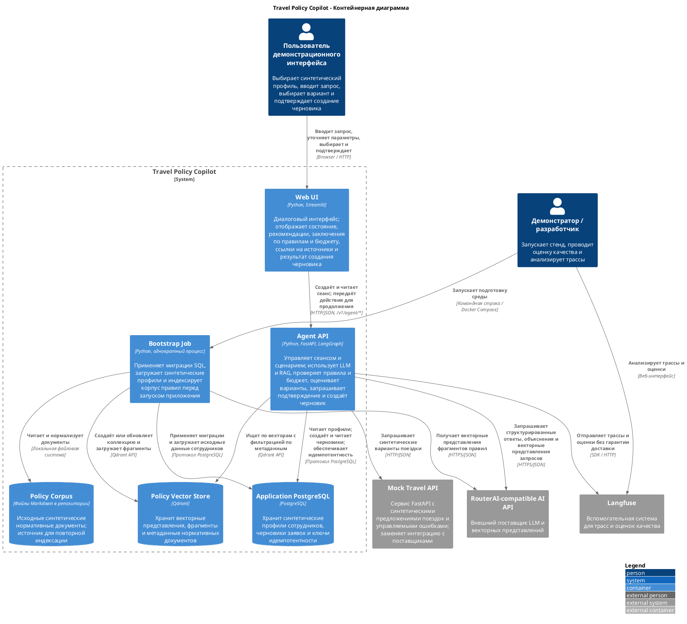

# Контейнерная архитектура Travel Policy Copilot

**Проект:** Travel Policy Copilot  
**Целевая инициатива:** Travel AI Platform  
**Тип документа:** C4, уровень 2 — контейнерная диаграмма  

---

## 1. Назначение документа

Документ декомпозирует Travel Policy Copilot с уровня системного контекста C1 до уровня исполняемых приложений и хранилищ C2. Он фиксирует:

- фактическую логическую границу MVP;
- ответственность контейнеров;
- внешние зависимости и протоколы;
- владение данными и состоянием;
- минимальные изменения C2 для перехода от MVP к пилотной эксплуатации.

---

## 2. Диаграмма контейнеров C2

---

## 3. Каталог контейнеров Travel Policy Copilot

| ID          | Контейнер              | Технология                   | Ответственность                                                                                                                                                     | Данные / состояние                                                                                     |
| ----------- | ---------------------- | ---------------------------- | ------------------------------------------------------------------------------------------------------------------------------------------------------------------- | ------------------------------------------------------------------------------------------------------ |
| `C2-UI`     | Web UI                 | Streamlit                    | Принимает запрос и действия пользователя; отображает рекомендации, ссылки на источники, состояние и результат                                                       | Хранит только состояние интерфейса; не является первичным хранилищем данных                            |
| `C2-API`    | Agent API              | FastAPI, LangGraph           | Управляет сценарием, вызывает LLM, инструменты и RAG, проверяет правила и бюджет, оценивает варианты, обеспечивает подтверждение пользователя и контролирует запись | Сеансы, контрольные точки и события аудита хранит в памяти; прикладные данные сохраняет через адаптеры |
| `C2-BOOT`   | Bootstrap Job          | Однократный процесс Python   | Применяет миграции SQL, загружает профили и индексирует корпус правил                                                                                               | После завершения не владеет данными; изменяет PostgreSQL и Qdrant                                      |
| `C2-PG`     | Application PostgreSQL | PostgreSQL                   | Долговременное хранение прикладных данных MVP                                                                                                                       | Профили сотрудников, черновики заявок, ключи идемпотентности                                           |
| `C2-QD`     | Policy Vector Store    | Qdrant                       | Производный индекс для семантического поиска                                                                                                                        | Векторы, фрагменты и метаданные источников и версий; перестраивается из корпуса                        |
| `C2-CORPUS` | Policy Corpus          | Файлы Markdown в репозитории | Версионируемый исходный набор нормативных документов                                                                                                                | Синтетические правила и метаданные для индексации                                                      |

### 5.1. Web UI

Web UI является тонким клиентом Agent API:

- не обращается напрямую к PostgreSQL, Qdrant, Mock Travel API или RouterAI;
- выбирает синтетический `employee_id`, но не выполняет аутентификацию пользователя;
- создаёт сессию, читает её состояние и отправляет разрешённые действия;
- не принимает самостоятельных решений о правилах, бюджете или возможности записи;
- отображает рекомендации, ссылки на источники, `approval_request_id` и `trace_id`, полученные от API.

### 5.2. Agent API

Agent API является основным прикладным контейнером и единственной точкой входа интерфейса в пользовательский сценарий. В его процессе находятся:

- управление графом LangGraph и переходы между состояниями;
- адаптер LLM;
- перечень инструментов и их адаптеры;
- поиск RAG и очистка контекста;
- детерминированные компоненты Policy Engine, Budget Check и Scoring;
- выбор, подтверждение и проверки перед записью;
- хранилище сеансов и контрольных точек в памяти процесса;
- адаптер наблюдаемости.

Перечисленные элементы не являются отдельными C2-контейнерами и будут декомпозированы на C3.

### 5.3. Bootstrap Job

Bootstrap Job отделён от Agent API, чтобы подготовка данных не выполнялась неявно в пользовательском запросе. Он:

1. применяет миграции SQL;
2. загружает синтетические профили сотрудников;
3. читает и нормализует корпус правил поездок;
4. получает векторные представления;
5. создаёт или обновляет коллекцию Qdrant;
6. завершает работу до запуска основного демонстрационного сценария.

Требование идемпотентности первоначальной подготовки записано в нефункциональных требованиях; её повторный запуск в рамках архитектурной работы независимо не проверялся.

### 5.4. Application PostgreSQL

Application PostgreSQL является первичным хранилищем прикладных данных MVP. Его следует отличать от PostgreSQL, который использует Langfuse.

В текущей границе PostgreSQL хранит:

- синтетические профили сотрудников;
- черновики заявок на согласование со статусом `draft_created`;
- ключи идемпотентности и связанные данные операций записи.

Он не хранит долговременно состояние сеанса, контрольные точки LangGraph или полный журнал аудита.

### 5.5. Policy Vector Store

Qdrant хранит производное представление корпуса правил поездок:

- векторные представления размерности 1024 в режиме `strict`;
- текстовые фрагменты;
- метаданные источника, раздела, версии и срока действия;
- данные для фильтрации и сопоставления ссылок с источниками.

Qdrant не является первичным источником нормативных данных. Индекс должен воспроизводимо перестраиваться из Policy Corpus.

### 5.6. Policy Corpus

Policy Corpus является версионируемым исходным набором синтетических документов. Он находится внутри границы Copilot, поскольку создаётся и сопровождается как часть учебного решения. При пилотной эксплуатации источником должна стать внешняя корпоративная база знаний с назначенным владельцем и определённым порядком обновления.

---

## 4. Внешние системы и акторы

| ID           | Система / актор                           | Роль относительно Copilot                                         | Доверие и отказ                                                                                            |
| ------------ | ----------------------------------------- | ----------------------------------------------------------------- | ---------------------------------------------------------------------------------------------------------- |
| `A-USER`     | Пользователь демонстрационного интерфейса | Выполняет основной сценарий                                       | Личность не проверяется; используются только синтетические данные; `employee_id` передаётся клиентом       |
| `A-MAINT`    | Демонстратор / разработчик                | Запускает стенд и анализирует подтверждающие сведения             | Участник эксплуатации, но не роль IAM приложения                                                           |
| `EXT-TRAVEL` | Mock Travel API                           | Выдаёт синтетические предложения и позволяет воспроизвести ошибки | Обязателен в режиме `strict`; ответы 4xx/5xx и истечение времени ожидания должны обрабатываться без записи |
| `EXT-AI`     | RouterAI-compatible AI API                | Ответы LLM и векторные представления                              | Внешняя недоверенная система; истечение времени ожидания или ошибка не должны разрешать запись             |
| `EXT-OBS`    | Langfuse                                  | Принимает трассы и оценки, предоставляет интерфейс анализа        | Отказ не должен нарушать основной сценарий; хранит собственные данные наблюдаемости                        |

---

## 5. Контракты взаимодействия

| Откуда → куда                      | Назначение                                       | Протокол / контракт                          | Передаваемые данные                                             | Поведение при отказе                                                                                       |
| ---------------------------------- | ------------------------------------------------ | -------------------------------------------- | --------------------------------------------------------------- | ---------------------------------------------------------------------------------------------------------- |
| Пользователь → Web UI              | Работа с диалогом                                | Браузер / HTTP                               | Текст запроса, выбранный синтетический сотрудник и действия     | Интерфейс показывает контролируемую ошибку                                                                 |
| Web UI → Agent API                 | Взаимодействие с агентом с сохранением состояния | HTTP/JSON                                    | `employee_id`, текст запроса, `session_id`, данные действия     | Недопустимое действие отклоняется; интерфейс не обращается к хранилищу напрямую                            |
| Agent API → Mock Travel API        | Поиск предложений                                | HTTP/JSON                                    | Типизированные параметры поездки                                | Пустой ответ, ошибка и истечение времени ожидания обрабатываются в ветви восстановления; запись запрещена  |
| Agent API → RouterAI               | Извлечение параметров, уточнение и объяснение    | HTTPS/JSON, интерфейс совместим с OpenAI API | Минимально необходимые данные пользователя и запроса            | Ошибка обрабатывается; проверки правил и записи остаются детерминированными                                |
| Agent API → RouterAI               | Векторное представление запроса                  | HTTPS/JSON                                   | Поисковый запрос                                                | В режиме `strict` ошибка RAG обрабатывается явно; в других режимах возможен обозначенный резервный вариант |
| Agent API → Application PostgreSQL | Чтение профиля и запись черновика                | Протокол PostgreSQL                          | Профиль сотрудника, черновик заявки, ключ идемпотентности       | При ошибке чтения или записи операция прекращается; запись без подтверждения невозможна                    |
| Agent API → Qdrant                 | Поиск правил                                     | Qdrant API                                   | Вектор запроса, фильтры метаданных, число результатов           | В режиме `strict` ошибка RAG обрабатывается явно; Policy Engine не обходится                               |
| Agent API → Langfuse               | Наблюдаемость                                    | SDK / HTTP                                   | Контекст трассы, события узлов, инструментов, LLM и RAG, оценки | Отказ не отменяет прикладной результат                                                                     |
| Bootstrap → PostgreSQL             | Подготовка реляционных данных                    | SQL / протокол PostgreSQL                    | Миграции схемы, исходные профили                                | API и интерфейс не должны считаться готовыми до обязательной подготовки                                    |
| Bootstrap → Policy Corpus          | Чтение источников для индексации                 | Локальная файловая система                   | Документы и метаданные                                          | Ошибка прекращает обязательную подготовку в режиме `strict`                                                |
| Bootstrap → RouterAI → Qdrant      | Построение векторного индекса                    | HTTPS/JSON + Qdrant API                      | Фрагменты, векторы, метаданные                                  | Ошибка прекращает индексацию в режиме `strict`; частичный индекс не считается готовым                      |

---

## 6. Владение данными и состоянием

| Данные                         | Владелец / первичный источник | Хранилище As-Is                | Долговечность                               |
| ------------------------------ | ----------------------------- | ------------------------------ | ------------------------------------------- |
| Профили сотрудников            | Учебный набор данных Copilot  | PostgreSQL                     | Долговременное хранение в локальном томе    |
| Черновики заявок               | Travel Policy Copilot         | PostgreSQL                     | Долговременное хранение в локальном томе    |
| Ключи идемпотентности          | Travel Policy Copilot         | PostgreSQL                     | Долговременное                              |
| Состояние сеанса               | Agent API                     | Память процесса                | Недолговременное                            |
| Контрольные точки LangGraph    | Agent API                     | Память процесса                | Недолговременное                            |
| События аудита                 | Agent API                     | Состояние агента               | Недолговременное                            |
| Исходные нормативные документы | Travel Policy Copilot         | Файлы репозитория              | Версионируются вместе с кодом               |
| Фрагменты правил и векторы     | Производные данные RAG        | Qdrant                         | Долговременное, с возможностью перестроения |
| Трассы и оценки качества       | Langfuse                      | Собственные хранилища Langfuse | Зависит от конфигурации Langfuse            |

---

## 7. Переход от MVP к пилотной эксплуатации: минимальные изменения C2

Следующая таблица описывает направление развития, но не утверждает, что целевое состояние уже реализовано.

| Область                    | MVP                                              | Целевое состояние при пилотной эксплуатации                                   | Причина                                                   |
| -------------------------- | ------------------------------------------------ | ----------------------------------------------------------------------------- | --------------------------------------------------------- |
| Идентификация              | Синтетический `employee_id`, переданный клиентом | Корпоративные IAM/SSO и подтверждённая личность                               | Закрыть недоверенную границу браузера                     |
| Данные сотрудников         | Профили в Application PostgreSQL                 | Доступ к внешней профильной системе HR через адаптер                          | Передать владение данными профильной системе              |
| Предложения поездок        | Mock Travel API                                  | Интеграция с поставщиками через реальные контракты                            | Заменить синтетический каталог                            |
| Сеансы и контрольные точки | Память процесса Agent API                        | Общее долговременное хранилище, например адаптер к PostgreSQL или Redis       | Продолжение после перезапуска и несколько экземпляров API |
| Аудит                      | События в состоянии агента                       | Отдельный долговременный журнал с добавлением записей и сроками хранения      | Расследование решений и соблюдение требований             |
| Согласование               | Локальный `draft_created`                        | Интеграция с системой согласования BPM                                        | Полный жизненный цикл заявки                              |
| Правила поездок            | Документы в репозитории                          | Загрузка из корпоративной базы знаний                                         | Владелец, версии, сроки действия и управляемая публикация |
| Наблюдаемость              | Локальный Langfuse; отказ не блокирует сценарий  | Интеграция с промышленными средствами наблюдаемости и SIEM, сроки хранения    | Эксплуатация и безопасность                               |
| Среда выполнения           | Docker Compose                                   | Среда пилотной эксплуатации; Kubernetes только при подтверждённой потребности | Не вводить оркестрацию без эксплуатационного обоснования  |

---

## 8. Архитектурные недостатки и риски C2

| ID       | Недостаток / риск                                                 | Влияние на C2                                                                              | Решение в документации                                                                          |
| -------- | ----------------------------------------------------------------- | ------------------------------------------------------------------------------------------ | ----------------------------------------------------------------------------------------------- |
| `C2-G01` | Сеансы и контрольные точки хранятся в памяти Agent API            | Незавершённый диалог теряется после перезапуска; горизонтальное масштабирование невозможно | Показать состояние внутри API; при пилотной эксплуатации вынести его в долговременное хранилище |
| `C2-G02` | IAM/SSO отсутствует                                               | Клиент сам передаёт данные о личности пользователя                                         | Ограничить MVP изолированной демонстрацией с синтетическими данными                             |
| `C2-G03` | Нет долговременного журнала аудита                                | Нельзя обеспечить полноценный аудит и управлять сроками хранения                           | Не выдавать события состояния агента за долговременный аудит                                    |
| `C2-G04` | Полнота трассы Langfuse не проверена                              | Не доказано, что трасса содержит все узлы, инструменты, поиск и запись                     | Отличать доставку событий от проверки полной трассы                                             |
| `C2-G05` | Имитационные и вспомогательные системы размещены вместе с Copilot | Логическую границу можно ошибочно принять за физическую                                    | C2 показывает владельца компонентов, а диаграмма развёртывания — их расположение                |
| `C2-G06` | Версии зависимостей и образов закреплены не полностью             | Воспроизводимость запуска может измениться со временем                                     | Рассмотреть фиксацию версий в эксплуатационной инструкции, не меняя границу C2                  |

Эти недостатки не препятствуют подготовке C2 и не требуют немедленной доработки агента. Они учитываются при подготовке C3, модели угроз, представления развёртывания, ADR и плана развития.

---

