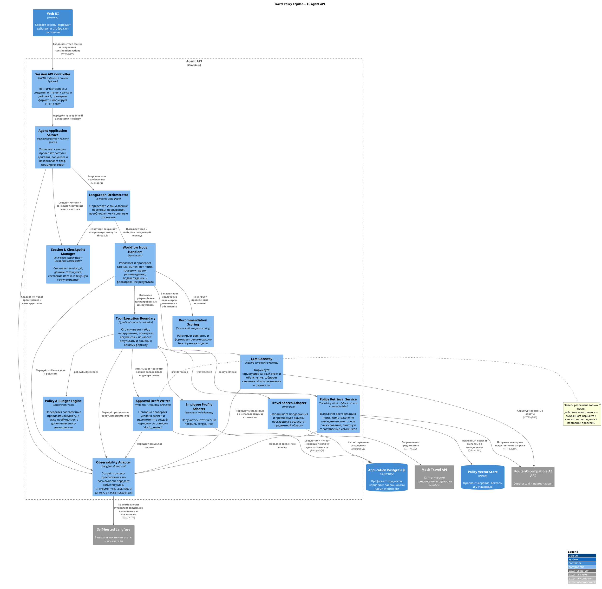

# Компонентная архитектура Agent API Travel Policy Copilot

**Проект:** Travel Policy Copilot  
**Целевая инициатива:** Travel AI Platform  
**Тип документа:** C4, уровень 3 — компонентная диаграмма  
**Декомпозируемый контейнер:** Agent API  

---

## 1. Назначение документа

Документ декомпозирует контейнер `Agent API`, определённый в `03-container-architecture.md`, до уровня логических компонентов. Он фиксирует:

- ответственность внутренних компонентов Agent API;
- направления допустимых зависимостей;
- границы управления сценарием, ИИ, детерминированной логики и инфраструктуры;
- управление состоянием сеансов и контрольными точками;
- путь чтения и защищённый путь записи;
- обработку ошибок и резервные режимы;
- меры безопасности и наблюдения;
- трассировку компонентов на требования;
- минимальный набор изменений уровня C3 для пилотной эксплуатации;
- отдельный план последующей верификации по исходному коду.

C3 не является диаграммой классов. Один логический компонент может быть реализован несколькими функциями или файлами, а несколько небольших компонентов могут находиться в одном Python-модуле. 

---

## 2. Диаграмма компонентов C3 — Agent API

Диаграмма фиксирует нормативные зависимости между ответственностями. Она не утверждает, что каждой ответственности соответствует отдельный Python-класс. Например, access control, action validation и graph invocation могут быть реализованы методами одного `AgentService`, но архитектурно относятся к application boundary, а не к LangGraph node или repository. Согласно имеющимся сведениям из исходного кода проверка допустимости действия с учётом состояния до возобновления графа не реализована полностью; поэтому эта связь является требуемой границей и зафиксированным пробелом, а не подтверждённым As-Is контролем.

---

## 3. Каталог компонентов

| ID      | Компонент                    | Основная ответственность                                                         |
| ------- | ---------------------------- | -------------------------------------------------------------------------------- |
| `C3-01` | Session API Controller       | HTTP transport, request/response schemas, routing                                |
| `C3-02` | Agent Application Service    | Session lifecycle, access/action guards, graph invoke/resume, response assembly  |
| `C3-03` | Session & Checkpoint Manager | In-memory привязка сеанса к владельцу и текущее состояние и LangGraph checkpoint |
| `C3-04` | LangGraph Orchestrator       | Graph topology, conditional routes, interrupts и terminal states                 |
| `C3-05` | Workflow Node Handlers       | Реализация шагов пользовательского сценария                                      |
| `C3-06` | LLM Gateway                  | Структурированные ответы, сопоставление ошибок провайдера, usage/cost            |
| `C3-07` | Tool Execution Boundary      | Typed contracts, allowlist, argument/result validation                           |
| `C3-08` | Employee Profile Adapter     | Получение данные сотрудника                                                      |
| `C3-09` | Travel Search Adapter        | HTTP integration и ошибка поставщика mapping                                     |
| `C3-10` | Policy Retrieval Service     | Query embedding, search, filtering, rerank, sanitization и citations             |
| `C3-11` | Policy & Budget Engine       | Deterministic заключения по правилам и бюджету                                   |
| `C3-12` | Recommendation Scoring       | Deterministic weighted ranking                                                   |
| `C3-13` | Approval Draft Writer        | Option validation, confirmation guard, idempotent draft write                    |
| `C3-14` | Observability Adapter        | Trace context, spans/events/scores, best-effort delivery                         |

---

## 4. Компонентные ответственности и границы

### 4.1. Session API Controller

Компонент отвечает только за границу передачи данных:

- принимает `POST /v1/agent/sessions`;
- принимает `GET /v1/agent/sessions/{session_id}`;
- принимает `POST /v1/agent/sessions/{session_id}/actions`;
- валидирует JSON по схемам Pydantic;
- преобразует результат и ошибки приложения в HTTP-ответ;
- не вызывает PostgreSQL, Qdrant, RouterAI или Mock Travel API напрямую.

Проверка входящего запроса не заменяет проверку данных предметной области внутри workflow.

### 4.2. Agent Application Service

Application Service связывает HTTP-запрос без состояния со сценарием с состоянием. Его ответственность:

- создать идентификаторы session/thread/trace;
- проверить принадлежность сессии переданным данным тестового сотрудника;
- загрузить сеансы и контрольные точки;
- вызвать или возобновить graph;
- сохранить новое состояние;
- сформировать безопасную проекцию результата для API;
- обеспечить ограничения при выполнении и отказ с сохранением запрета на запись перед записи.

### 4.3. Session & Checkpoint Manager

Логический компонент объединяет две связанные, но потенциально раздельные ответственности:

1. хранилище сеансов API — привязка к владельцу, текущее состояние и доступные actions;
2. LangGraph checkpointer — продолжение выполнение графа по `thread_id`.

### 4.4. LangGraph Orchestrator

Orchestrator определяет топологию и управление переходами:

- начальное и конечные состояния;
- проверку полноты запроса;
- прерывания для уточнения, выбора и подтверждения;
- условные переходы при наличии и отсутствии вариантов, ошибке и отклонении всех вариантов по правилам;
- восстановление через изменение ограничений, повторный запрос или отмену;
- переход к записи только из подтверждённого состояния;
- верхнюю границу шагов/итераций.

### 4.5. Workflow Node Handlers

Node Handlers реализуют прикладные шаги графа:

- разобрать и проверить запрос;
- задать уточняющий вопрос;
- получить профиль сотрудника;
- найти варианты поездки;
- найти применимые правила;
- проверить правила и бюджет;
- ранжировать и представить рекомендации;
- предложить изменить ограничения;
- запросить подтверждение;
- создать черновик заявки;
- показать результат.

### 4.6. LLM Gateway

Шлюз изолирует особенности API провайдера и должен обеспечивать:

- контракт клиента, совместимый с OpenAI;
- структурированный вывод для извлечения данных;
- валидацию/нормализацию ответа провайдера;
- ограничение времени ожидания и сопоставление ошибок провайдера;
- сведения об использовании, токенах;
- отсутствие прямого разрешения выполнение инструмента или запись со стороны LLM.

### 4.7. Tool Execution Boundary

Компонент является границей возможностей агента:

- содержит фиксированный перечень разрешённых инструментов;
- валидирует типизированные входные и выходные контракты;
- не допускает произвольные URL, SQL или исполнение произвольного кода;
- централизует вызов адаптеров чтения и записи;
- нормализует ошибки внешних систем в результаты предметной области;
- передаёт данные для наблюдения;
- не позволяет инструмент записи исполняться вне разрешённого состояния графа.

### 4.8. Адаптеры чтения

`Employee Profile Adapter`, `Travel Search Adapter` и `Policy Retrieval Service` не изменяют данные приложения:

- Profile Adapter читает синтетический данные сотрудника;
- Travel Adapter получает синтетические offers по HTTP;
- RAG Service строит векторное представление запроса, извлекает и подготавливает контекст правил.

### 4.9. Компоненты детерминированного принятия решений

Policy & Budget Engine и Recommendation Scoring отделены от LLM:

- Policy Engine применяет формализуемые правила;
- Проверка бюджета сравнивает стоимость с лимитом профиля;
- результат `fail` не может быть превращён LLM в допустимый вариант;
- scoring воспроизводим для одинаковых входных данных;
- текущий scoring не называется обучаемой моделью рекомендаций.

### 4.10. Approval Draft Writer

Компонент записи выполняется только после подтверждения человеком. Перед записью он должен повторно проверить:

- существование и принадлежность сеанса;
- ожидаемый состояния графа;
- наличие выбранного `option_id`;
- принадлежность варианта текущему набору рекомендаций;
- допустимость условий применения правил и записи;
- наличие явного подтверждения;
- детерминированного ключа идемпотентности.

Ограничение уникальности в PostgreSQL является второй линией защиты от повторной записи.

### 4.11. Адаптер наблюдения

Adapter скрывает Langfuse SDK и обеспечивает передачу данных без влияния на основной сценарий:

- создаёт общий контекст трассировки;
- связывает session/thread/trace identifiers;
- записывает node, LLM, tool, retrieval, HITL и write events;
- публикует результаты оценки;
- не передаёт ошибку наблюдения в сбой основного сценария;
- не участвует в решении по правилам или записи.

---

## 5. Правила направлений зависимостей

| Правило | Разрешено | Запрещено |
|---|---|---|
| API boundary | Controller → Application Service | Controller → PostgreSQL/Qdrant/external API напрямую |
| Workflow | Application Service → LangGraph → Nodes | Infrastructure адаптер → LangGraph transition |
| AI | Nodes → LLM Gateway | LLM response → прямое изменение БД или результат проверки правил |
| Tools | Nodes → Tool Boundary → Adapter | Node → произвольный HTTP/SQL/code execution |
| Decisions | Nodes/Tool Boundary → Policy/Scoring | Policy/Scoring → RouterAI для формального verdict |
| State | Application Service/LangGraph → State Manager | UI/external system → in-memory checkpoint напрямую |
| Write | Confirmed node → Tool Boundary → Approval Writer | Read node/LLM/observability → Approval Writer напрямую |
| Observability | Components → Observability Adapter → Langfuse | Langfuse → business decision или state mutation |

---

## 6. Переход от MVP к пилотной эксплуатации: минимальные изменения C3

| Компонентная область | MVP                                        | Целевое состояние при пилотной эксплуатации | Изменение C3                                                            |
| -------------------- | ------------------------------------------ | ------------------------------------------- | ----------------------------------------------------------------------- |
| API identity         | Передаваемый клиентом `employee_id`        | Подтверждение личности через IAM            | Добавить Authentication/Authorization Adapter перед Application Service |
| State management     | In-memory сеансы и контрольные точки       | Долговременное общее хранилище              | Заменить реализацию State Manager без изменения graph contract          |
| Audit                | Events в agent state                       | Долговременный журнал аудита                | Добавить Audit Port/Adapter как отдельную ответственность               |
| Employee profile     | Локальный репозиторий в PostgreSQL         | HR/Profile API адаптер                      | Заменить адаптер                                                        |
| Travel search        | Mock HTTP адаптер                          | Интеграция с системами поиска ибронирования | Сохранить типизированный порт для поиска и обработки ошибок             |
| Approval write       | Локальный репозиторий для черновика заявки | BPM/Approval API адаптер                    | Сохранить проверку подтверждения/идемпотентности до внешней записи      |
| Policy knowledge     | Локальный корпус в Qdrant                  | Управляемая База Знаний загрузка и поиск    | Добавить ответственного за публикацию и версии вне Agent API            |
| Observability        | Langfuse                                   | Production telemetry + SIEM                 | Расширить адаптер, не связывая его с business decisions                 |
| Scaling              | Один stateful API process                  | Несколько stateless API реплик              | Вынести state/checkpoint и обеспечить управление параллельным доступом  |

---
