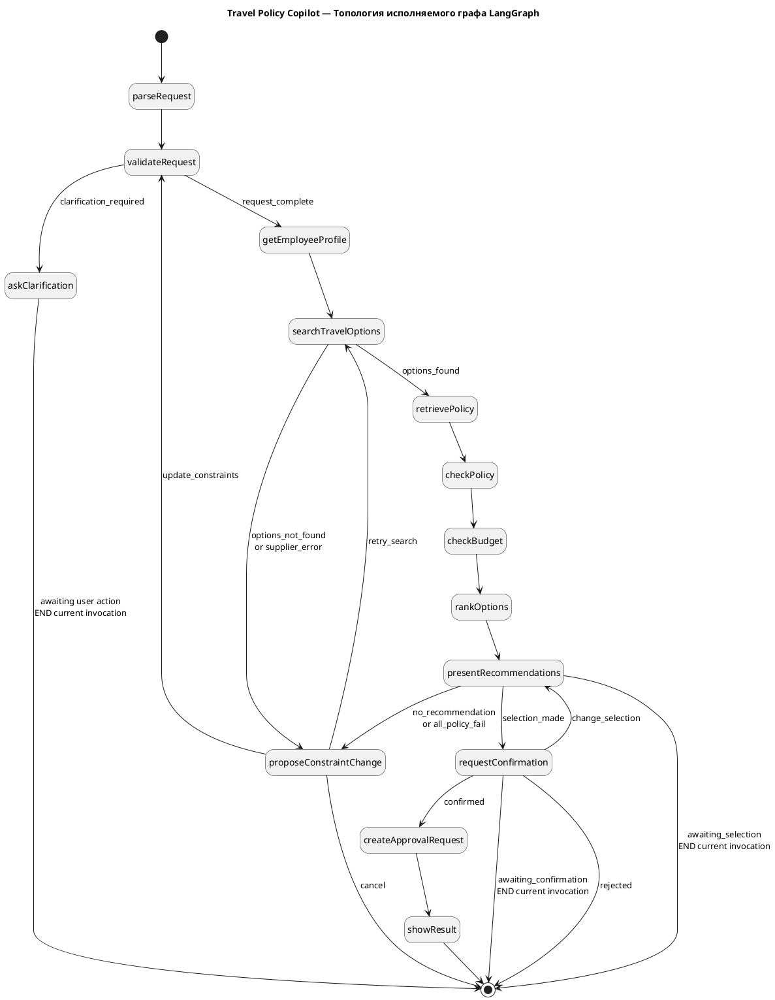
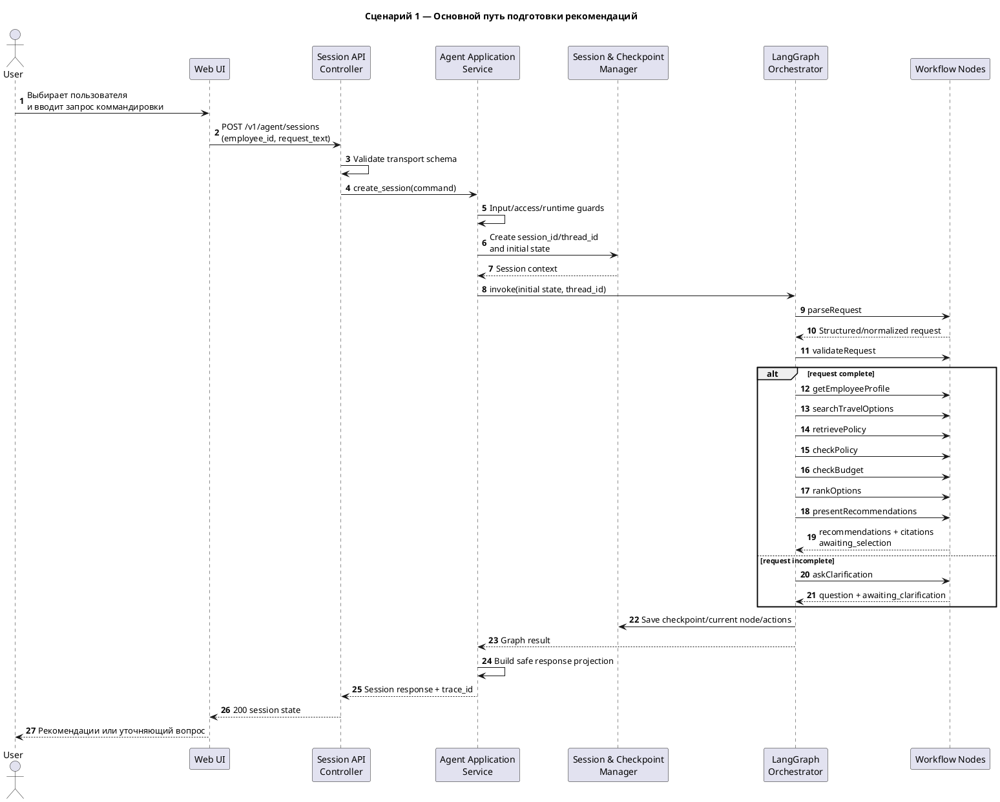
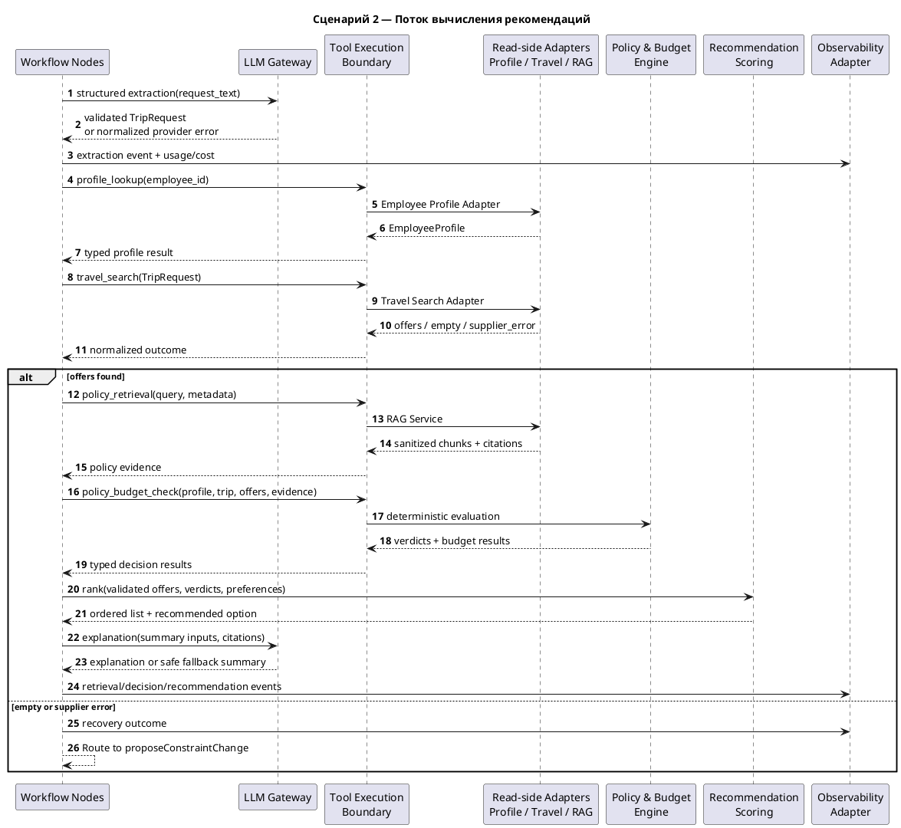
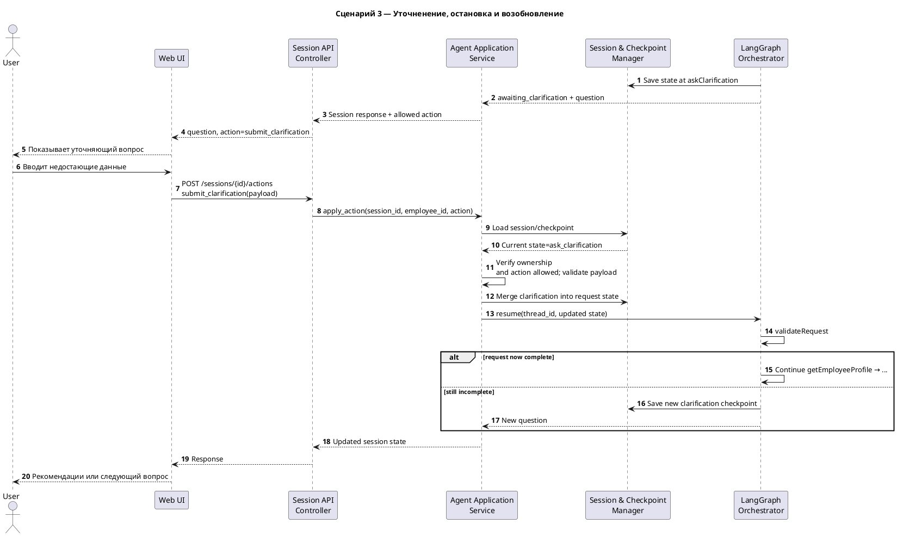
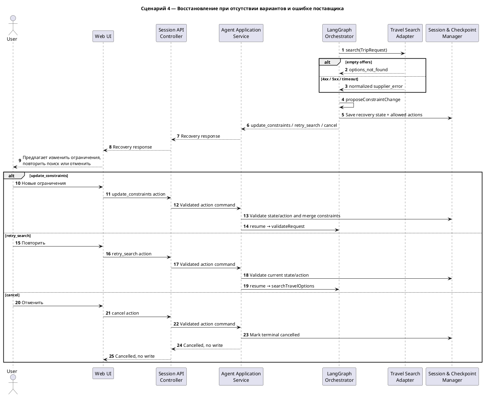
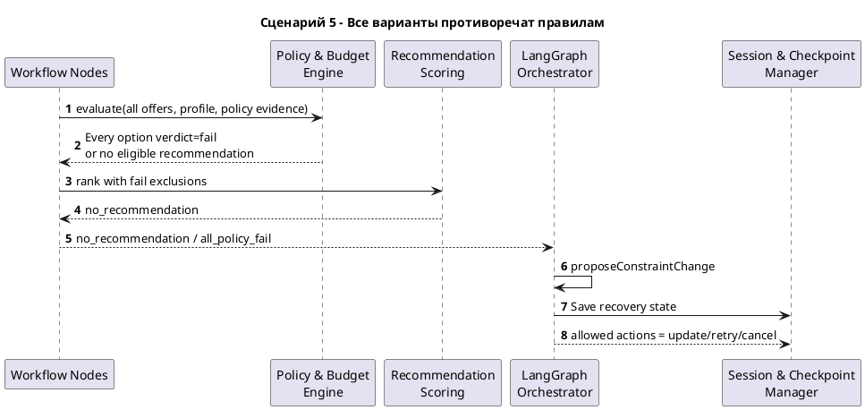
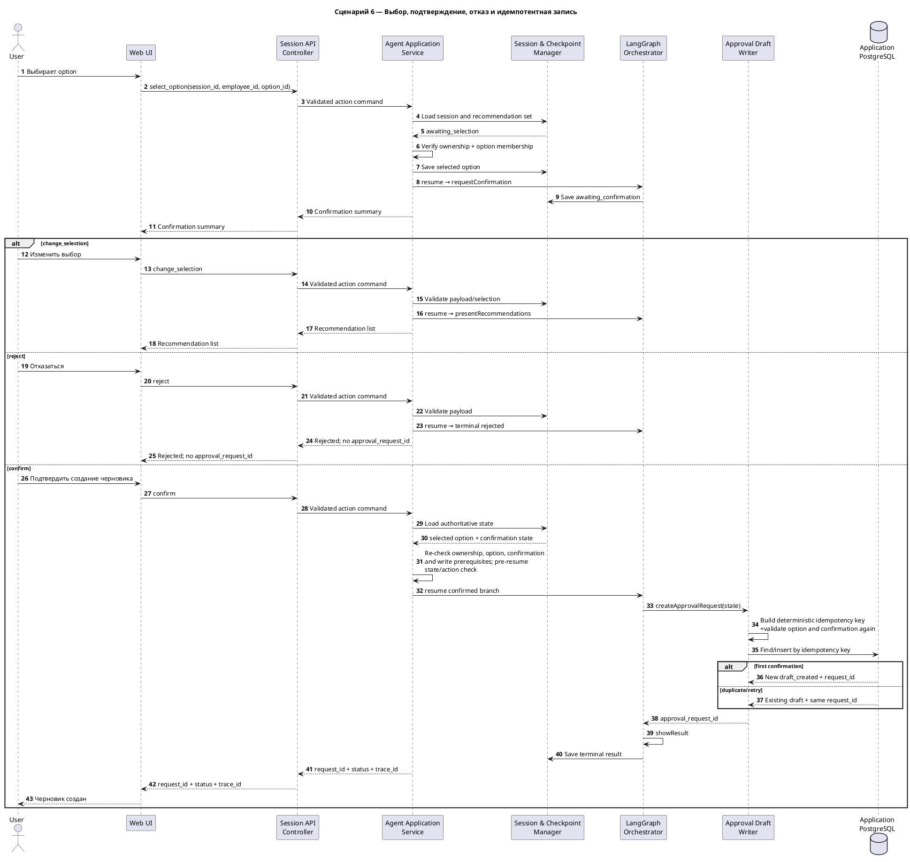

# Динамическая архитектура Travel Policy Copilot

**Проект:** Travel Policy Copilot  
**Целевая инициатива:** Travel AI Platform  
**Тип документа:** динамическая архитектура — граф состояний LangGraph и диаграммы последовательности  

---

## 1. Назначение документа

Документ описывает поведение Travel Policy Copilot во времени и дополняет статические представления C1–C3. Он фиксирует:

- структуру сценария LangGraph;
- прерывание и возобновление работы, допустимые действия пользователя;
- основной успешный сценарий;
- уточнение неполного запроса;
- восстановление при отсутствии вариантов и ошибках поставщика;
- обработку ситуации, когда все варианты нарушают политику;
- выбор, изменение выбора, подтверждение и отказ;
- защищённый идемпотентный путь записи;
- инварианты безопасности при выполнении;

Документ использует имена компонентов из `04-agent-component-architecture.md`. 

---

## 2. Участники динамических сценариев

| Участник                            | Уровень               | Роль                                                                                               |
| ----------------------------------- | --------------------- | -------------------------------------------------------------------------------------------------- |
| Пользователь                        | Действующее лицо      | Вводит запрос, уточняет параметры, выбирает вариант и подтверждает или отклоняет запись            |
| Web UI                              | Контейнер C2          | Отправляет запросы сеанса и действия и отображает текущее состояние                                |
| Session API Controller              | Компонент C3          | Проверка запросов и граница HTTP                                                                   |
| Agent Application Service           | Компонент C3          | Управление сеансом, проверка доступа и действий, запуск и возобновление графа, формирование ответа |
| Session & Checkpoint Manager        | Компонент C3          | Изменяемое состояние сеанса и контрольной точки в памяти процесса                                  |
| LangGraph Orchestrator              | Компонент C3          | Узлы, условные переходы, прерывания и конечные состояния                                           |
| Workflow Node Handlers              | Компонент C3          | Шаги сценария приложения                                                                           |
| LLM Gateway                         | Компонент C3          | Извлечение параметров, уточнение и объяснение                                                      |
| Tool Execution Boundary             | Компонент C3          | Вызов разрешённых типизированных инструментов                                                      |
| Profile / Travel / RAG adapters     | Компонент C3s         | Интеграции для чтения                                                                              |
| Policy & Budget Engine              | Компонент C3          | Детерминированные результаты проверки                                                              |
| Recommendation Scoring              | Компонент C3          | Детерминированное ранжирование                                                                     |
| Approval Draft Writer               | Компонент C3          | Идемпотентная запись                                                                               |
| Observability Adapter               | Компонент C3          | Передача записей выполнения, событий и показателей без влияния на основной сценарий                |
| PostgreSQL / Qdrant / external APIs | Зависимости уровня C2 | Сохраняемые данные и внешние возможности                                                           |

---

## 3. Структура выполнения LangGraph

Диаграмма ниже показывает узлы и переходы графа. 

## 4. Модель взаимодействующих состояний и действий

| Состояние взаимодействия / узел | Допустимые действия | Следующая точка | Запись разрешена |
|---|---|---|---|
| `ask_clarification` | `submit_clarification` | `validateRequest` после обновления состояния запроса | Нет |
| `propose_constraint_change` | `update_constraints` | `validateRequest` | Нет |
| `propose_constraint_change` | `retry_search` | `searchTravelOptions` | Нет |
| `propose_constraint_change` | `cancel` | Отменено | Нет |
| `present_recommendations` | `select_option` | `requestConfirmation` | Нет |
| `request_confirmation` | `confirm` | `createApprovalRequest` после повторных проверок | Да, только в этой ветви |
| `request_confirmation` | `reject` | Отклонено | Нет |
| `request_confirmation` | `change_selection` | `presentRecommendations` | Нет |

---

## 5. Сценарий 1 — создание сеанса и основная последовательность подготовки рекомендации

Диаграмма разделяет жизненный цикл сеанса HTTP и вычислительный сценарий. Запись в этом сценарии ещё не выполняется.

### Инварианты

- Controller не обращается к внешним adapters или storage напрямую.
- `session_id`, `thread_id` и данные сотрудника связываются до вызова графа.
- Неполный запрос не запускает поиск вариантов и путь записи.
- Рекомендации формируется только после получения профиля, вариантов, оценки политик и формальных проверок.

---

## 6. Сценарий 2 — внутреннее формирование рекомендаций

Диаграмма раскрывает взаимодействия компонентов внутри node pipeline, скрытые в Sequence 1.

### Инварианты

- LLM извлечение проходит типизированную проверку.
- Tool Boundary разрешает только зарегистрированные инструменты.
- Полученный контент считается данными, а не управляющими инструкциями.
- Решения по политикам/бюджету вычисляется детерминированно.
- LLM объяснение не может изменить решение.

---

## 7. Сценарий 3 — уточнение, остановка и возобновление

### Инварианты

- Ответ применяется к существующей session, а не создаёт новую.
- До заполнения обязательных параметров не вызываются profile/travel/RAG/write инструменты.

---

## 8. Сценарий 4 — восстановление при отсутствии вариантов и ошибке поставщика

### Правила восстановления

- Ошибка сервиса поиска и бронирования не преобразуется в пустой успешный набор рекомендаций.
- `retry_search` не изменяет ограничения автоматически.
- `update_constraints` возвращает поток к проверке, а не напрямую к сохранению заявки.

---

## 9. Сценарий 5 — все варианты противоречат правилам

### Инварианты

- Вариант с формальным `fail` не становится рекомендованным из-за цены или удобства.
- Наличие вариантов поставщика не означает наличие допустимой рекомендации.

---

## 10. Сценарий 6 — выбор, подтверждение, отказ и идемпотентная запись

### Инварианты

1. `select_option` не создаёт черновик.
2. `change_selection` возвращает пользователя к recommendation state.
3. `reject` заканчивает сценарий без записи.
4. `option_id` повторно проверяется непосредственно перед записью.
5. `createApprovalRequest` достижим только из ветки подтверждения.
6. Ключ идемпотентности определен для одной логической операции.
7. Повторный `confirm` не создаёт вторую строку.
8. Ограничение уникальности в БД является второй линией защиты.
9. Ошибка Langfuse не откатывает успешный запись данных приложения и не инициирует повторную запись.

---
