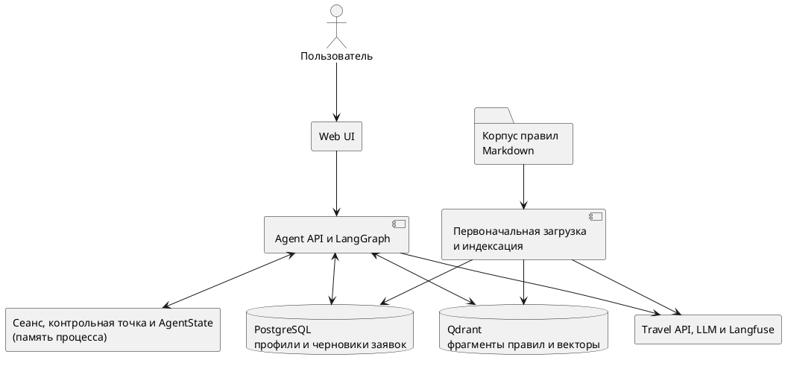
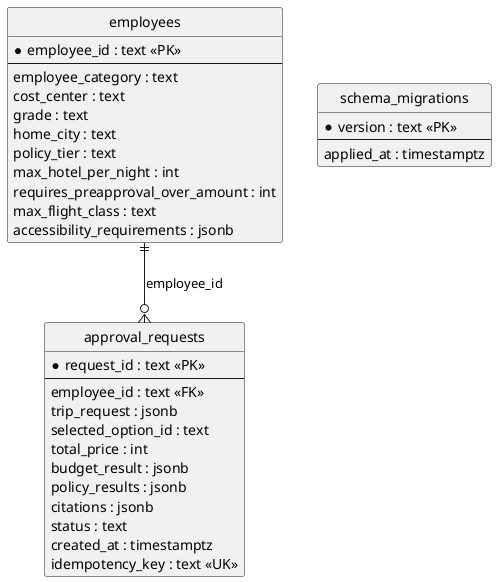
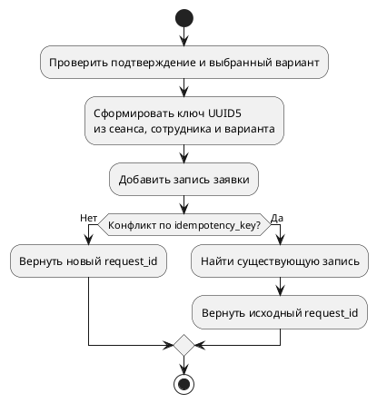
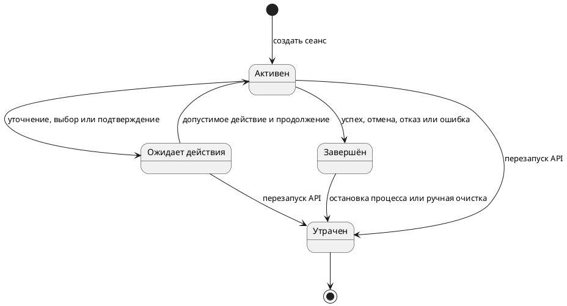
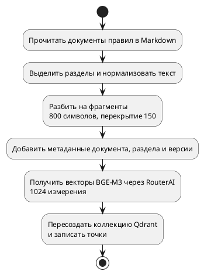
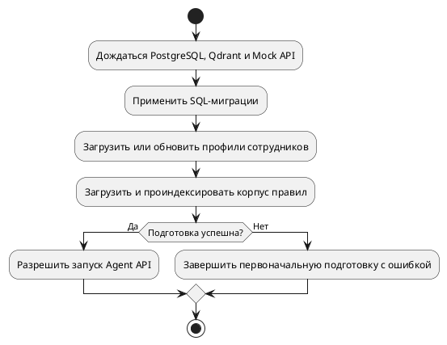
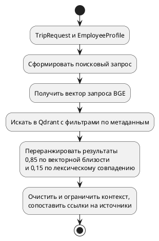
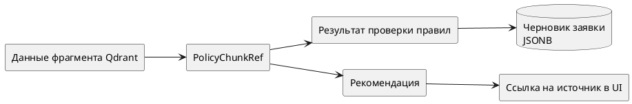

# Архитектура данных и RAG Travel Policy Copilot

**Проект:** Travel Policy Copilot  
**Целевая инициатива:** Travel AI Platform  
**Тип документа:** архитектура данных, ER-модель и архитектура RAG  

---

## 1. Назначение документа

Документ описывает информационную архитектуру реализованного Travel Policy Copilot:

- логическую модель предметных данных и данных ИИ;
- физическую модель PostgreSQL;
- распределение данных между PostgreSQL, Qdrant, состоянием LangGraph, хранилищем сеансов и Langfuse;
- жизненный цикл состояния диалога и черновика заявки;
- pipeline загрузки корпуса правил поездок;
- поиск, повторное ранжирование, очистку и формирование ссылок на источники;
- правила владения, классификации, версионирования и удаления данных;
- границу между RAG, детерминированной проверкой правил и LLM;

---

## 2. Правила моделирования данных

1. PostgreSQL является первичным источником данных только для профилей сотрудников и созданных черновиков заявок.
2. Qdrant является производным индексом поиска; подлинники нормативных документов хранятся отдельно.
3. Документы Markdown являются источником для загрузки корпуса правил поездок, но ответственное лицо и официальный статус документов требуют подтверждения.
4. Session store, LangGraph checkpoint и AgentState являются различными логическими структурами, хотя все они находятся в памяти одного процесса.
5. Travel options поступают от Mock Travel API и не имеют отдельного долговременного хранилища в Copilot.
6. Policy/budget verdicts вычисляются детерминированным кодом; LLM не является источником истины для формальных решений.
7. Структурированные цитаты формируются на основе извлеченных данных, а не генерируются LLM.

---

## 3. Общая карта данных

Ключевое разделение:

- **долговременные данные приложения:** PostgreSQL;
- **производный индекс знаний:** Qdrant;
- **состояние сценария в памяти процесса:** Agent API память процесса;
- **исходные документы:** локальный корпус Markdown;
- **external telemetry:** Langfuse;
- **временные данные поставщика и модели:** Mock Travel API и RouterAI-compatible API.

---

## 4. Каталог информационных объектов

| Объект                     | Назначение                                            | Источник данных                    | Форма хранения                                 | Долговечность                                      |
| -------------------------- | ----------------------------------------------------- | ---------------------------------- | ---------------------------------------------- | -------------------------------------------------- |
| Employee Profile           | Категория сотрудника, лимиты и применимые ограничения | PostgreSQL `employees`             | Row + `EmployeeProfile`                        | Длительно локальное хранение                       |
| Запрос поездки             | Типизированные параметры поездки                      | Текущий сеанс                      | `TripRequest` в AgentState; JSONB после записи | В памяти до записи; затем снимок запроса           |
| Travel Option              | Предложение маршрутов                                 | Mock Travel API response           | `TravelOption` в AgentState                    | Временные                                          |
| Документ правил            | Исходный нормативный текст                            | Корпус Markdown                    | `data/policies/*.md`                           | Постоянный файл репозитория                        |
| Фрагмент правил            | Фрагмент документа с указанием происхождения          | Производный индекс Qdrant          | Вектор и метаданные; `PolicyChunkRef` в state  | Том с сохранением данных; индекс можно перестроить |
| Результат проверки правил  | Детерминированное решение                             | Выход проверки правил              | `PolicyCheckResult`                            | В памяти; после записи сохраняется снимок JSONB    |
| Результат проверки бюджета | Проверка лимита                                       | Выход инструмента проверки бюджета | `BudgetCheckResult`                            | В памяти; после записи сохраняется снимок JSONB    |
| Recommendation             | Ранжированный option и explanation                    | Scoring + optional LLM wording     | `Recommendation`                               | Временные                                          |
| Approval Request           | Черновик после HITL                                   | PostgreSQL `approval_requests`     | Row + JSONB fields                             | Длительно локальное хранение                       |
| Session Record             | API-контекст диалога и владелец                       | In-memory хранилище сеансов        | Process-local record                           | Временные                                          |
| LangGraph Checkpoint       | Состояние interrupt/resume                            | `InMemorySaver`                    | Process-local checkpoint                       | Временные                                          |
| Событие аудита             | Событие узла, инструмента или действия                | AgentState                         | Список структурированных событий               | В памяти                                           |
| Трассировка и оценка       | Данные для наблюдения                                 | Langfuse, если включён             | Внешние события, этапы и показатели            | Длительное внешнее хранение                        |

---

## 5. Логическая модель предметных данных

### 5.1. Основные модели

| Модель | Ключевые атрибуты | Производитель | Основные потребители |
|---|---|---|---|
| `EmployeeProfile` | идентификатор сотрудника, category, cost center, grade, home city, policy tier, hotel limit, preapproval threshold, max fare, accessibility | Profile Repository | Search, RAG filter, Policy Engine, Budget Tool |
| `TripRequest` | origin/destination, dates, meeting constraints, segments, preferences, hotel need, comment | LLM parser + validation | Travel Search, RAG query, запись заявки |
| `TravelOption` | option ID, transport, datetimes, carrier/fare, hotel, component prices, total | Mock Travel API | Policy Engine, Budget Tool, Scoring |
| `PolicyChunkRef` | document/section IDs, path, score, version, дата вступления в силу, category, rule type, text | Retrieval Service | Policy Engine, explanation, citations |
| `PolicyCheckResult` | rule ID, verdict, message, citations | Policy Engine | Scoring, UI, черновик заявки |
| `BudgetCheckResult` | verdict, total, threshold, overage, currency semantics | Budget Tool | Scoring, UI, черновик заявки |
| `Recommendation` | option ID, component scores, total score, recommended flag, explanation, citations | Scoring + optional LLM wording | UI, selection guard |
| `ApprovalRequest` | идентификатор запроса, employee, trip snapshot, selected option ID, price, verdicts, citations, status, timestamp, ключ идемпотентности | Approval Draft Writer | PostgreSQL, result UI |

## 6. Физическая ER-модель PostgreSQL

### 6.1. Таблица `employees`

| Группа полей  | Назначение                                           | Ограничения As-Is                              |
| ------------- | ---------------------------------------------------- | ---------------------------------------------- |
| Identity      | `employee_id`                                        | PK; production identity не подтверждена IAM    |
| Organization  | category, cost center, grade, home city, policy tier | Все поля обязательны                           |
| Entitlements  | hotel limit, preapproval amount, max flight class    | Целые RUB-пороговые значения и строковый класс |
| Accessibility | `accessibility_requirements`                         | JSONB, default `[]`                            |

### 6.2. Таблица `approval_requests`

Таблица хранит достаточный для демонстрации draft, но неполный снимок, достаточный для воспроизведения принятого решения.

| Сохраняется | Не сохраняется отдельным атрибутом |
|---|---|
| Employee ID | Полный snapshot Employee Profile и его версия |
| Trip Request JSONB | Полный snapshot выбранного Travel Option |
| Selected option ID | Валюта |
| Total price | Session ID и идентификатор трассировки |
| Policy results | Версии ранжирования, конфигурации и модели |
| Budget result | Версия корпуса правил поездок как отдельное поле |
| Citations | Approval actor и confirmation timestamp |
| Status/created_at/ключ идемпотентности | История смены статуса |

---

## 7. Согласованность записи и идемпотентность

### 7.1. Алгоритм 

### 7.2. Уровни защиты

| Уровень     | Механизм                                                      |
| ----------- | ------------------------------------------------------------- |
| Graph       | Узел сохранения достижим только после подтверждения           |
| Node        | Повторная проверка подтверждения и выбранного варианта        |
| Domain/tool | Создание `ApprovalRequest` только через явный контракт записи |
| Database    | `UNIQUE(idempotency_key)`                                     |
| Repository  | `ON CONFLICT DO NOTHING` + чтение существующей строки         |

### 7.3. Ограничения

- Выбор другого варианта меняет ключ и допускает новый черновик в том же сеансе.
- В таблице нет `session_id`, поэтому обратная корреляция выполняется только через алгоритм ключа и внешние traces.

---

## 8. Состояние в памяти процесса: сеанс, контрольные точки и AgentState

### 8.1. Три уровня состояния

| Уровень              | Владелец                         | Назначение                                        | Ключ                                                  | Долговечность                                              |
| -------------------- | -------------------------------- | ------------------------------------------------- | ----------------------------------------------------- | ---------------------------------------------------------- |
| Session Record       | Agent API `InMemorySessionStore` | API ответ и текущее состояние                     | `session_id` + employee check                         | До перезапуска или очистки                                 |
| LangGraph Checkpoint | `InMemorySaver`                  | Сценарий остановки/возобновления                  | `thread_id`; при bootstrap равен идентификатор сеанса | До перезапуска                                             |
| AgentState           | LangGraph workflow               | Все данные выполнения, actions, events и outcomes | Внутри checkpoint/session                             | До перезапуска; отдельные поля сохраняются в БД при записи |

Эти структуры совместно обслуживают один диалог, но не являются одной физической записью и не должны изображаться как PostgreSQL entity.

### 8.2. Группы полей AgentState

| Группа | Поля / примеры | Lifecycle |
|---|---|---|
| Correlation | session, thread, employee, trace IDs | Начало сеанса → завершение или остановка процесса |
| User input | last message, TripRequest, missing fields, clarification | Разбор и объединение → завершение сеанса |
| External data | EmployeeProfile, TravelOptions | Вызовы инструментов → завершение сеанса |
| RAG | chunks, assembled context, embedding usage | Поиск → завершение сеанса |
| Decision | policy, budget, recommendations | Проверка и ранжирование → возможный снимок в БД |
| HITL | selected option, confirmation status | Selection/confirmation → terminal |
| Side effect | approval идентификатор запроса | Write → result/terminal |
| Observability | вызовы инструментов/events, audit, routes, usage, degraded components | Добавление или замена → потеря при остановке процесса |
| Guard state | current step, iteration and transition counters, error | Управление сценарием → завершение |

### 8.3. Жизненный цикл состояния сеанса

### 8.4. Ограничения

- Для сеансов не установлены срок жизни и автоматическая очистка.
- Нет длительного хранения и восстановления после повторного запуска.
- Нет проверки версии или одноразового идентификатора для устаревшего действия.
- Audit events существуют только в AgentState.

---

## 9. Корпус правил поездок

### 9.1. Состав исходного корпуса

| Document ID         | Файл                   | Область                                    |
| ------------------- | ---------------------- | ------------------------------------------ |
| `POLICY-GENERAL`    | `general_policy.md`    | Общие принципы, оформление и подтверждение |
| `POLICY-TRANSPORT`  | `transport_policy.md`  | Транспортные классы и ночные отправления   |
| `POLICY-HOTEL`      | `hotel_limits.md`      | Лимиты проживания                          |
| `POLICY-BUDGET`     | `budget_policy.md`     | Бюджет и предварительное согласование      |
| `POLICY-EXCEPTIONS` | `exceptions_policy.md` | Исключения accessibility/mobility          |

`POLICY-MALICIOUS` используется как корпус для проверки безопасности и индексируется в отдельную коллекцию с суффиксом `_security`. Он не должен попадать в обычный поиск.

## 10. Архитектура загрузки и индексации для RAG

### 10.1. Последовательность первоначальной подготовки

Пересоздание данных при запуске приемлемо для небольшого учебного корпуса и локального запуска. Для Pilot требуется версионируемое/blue-green индексирование.

---

## 11. Физическая модель Qdrant

### 11.1. Коллекции

| Параметр | Default corpus | Security-test corpus |
|---|---|---|
| Name | `travel_policy_chunks_baai_bge_m3_v1` | Default name + `_security` |
| Vector | Unnamed | Unnamed |
| Dimension | 1024 по default config; фактическая длина используется при create | То же |
| Distance | COSINE | COSINE |
| Payload indexes | Нет | Нет |
| Replication/sharding | Не настроены; defaults Qdrant | Не настроены; defaults Qdrant |
| Lifecycle | Delete → create → upsert | Delete → create → upsert |

### 11.2. Структура дополнительных данных

| Field                 | Тип             | Семантика                      | Использование в query                   |
| --------------------- | --------------- | ------------------------------ | --------------------------------------- |
| `document_id`         | string          | Устойчивый ID документа        | Citation/result                         |
| `document_title`      | string          | Отображаемое название          | UI/citation                             |
| `policy_version`      | string          | Версия policy                  | Exact filter `v0.2`                     |
| `section_id`          | string          | ID секции/chunk                | Citation и point seed                   |
| `section_title`       | string          | Заголовок                      | Context/UI                              |
| `effective_from`      | ISO date string | Начало действия                | Только metadata; по дате не фильтруется |
| `employee_category`   | string          | `all` либо категория           | Filter                                  |
| `rule_type`           | string          | Вид правила/security test      | Exclude `security_test`                 |
| `test_namespace`      | string          | Default/security separation    | Физическая/логическая изоляция          |
| `source_path`         | string          | Отслеживание данных в Markdown | Citation                                |
| `chunk_text`          | string          | Retrieved text                 | Reranking/context                       |
| `embedding_provider`  | string          | Provider provenance            | Не фильтруется                          |
| `embedding_model`     | string          | Model provenance               | Входит в collection name                |
| `embedding_dimension` | integer         | Vector provenance              | Validate/config                         |
| `collection_version`  | string          | Index schema version           | Collection naming                       |
| `corpus_version`      | string          | Corpus snapshot                | Exact filter `v1`                       |

### 11.3. Что не является первичным источником данных

Qdrant не должен считаться владельцем:

- исходного нормативного документа;
- полного Employee Profile;
- результат проверки правил;
- истории approval request;
- состояния сессии.

---

## 12. Архитектура поиска RAG

### 12.1. Этапы поиска

| Этап                | Реализация                                                                                |
| ------------------- | ----------------------------------------------------------------------------------------- |
| Query construction  | Строка вида `travel policy <origin> <destination>`                                        |
| Query embedding     | BGE query prefix; эмбединг во внешней LLM                                                 |
| Candidate retrieval | Qdrant limit 48                                                                           |
| Metadata filters    | corpus `v1`; policy `v0.2`; category `all` или profile category; исключён `security_test` |
| Application top-k   | 12                                                                                        |
| Reranking           | `0.85 × dense score + 0.15 × lexical overlap`                                             |
| Context selection   | Первые 5 chunks                                                                           |
| Context limit       | 2400 characters                                                                           |
| Sanitization        | Regex удаляет распознанные вредоносные строки                                             |
| Citation mapping    | Payload → `PolicyChunkRef`                                                                |

## 13. Ссылки на источники и граница проверки обоснованности

### 13.1. Порядок формирования структурированных ссылок

### 13.2. Реализованные гарантии

- Структурированная цитата содержит document ID, section ID, path, version и дата вступления в силу.
- Цитаты в рекомендации копируется из найденные фрагменты.
- LLM не создаёт `PolicyChunkRef` и не меняет результат проверки правил.
- UI отображает идентификаторы/путь/score источника.
- Утвержденный черновик заявки сохраняет JSONB с цитатой.

### 13.3. Ограничения

- LLM может сформулировать свободный текст, содержащий неподтверждённое утверждение.
- Функция валидации ограничивается проверкой структурной целостности и заполненности полей; семантическая связь с исходным блоком текста при этом не оценивается.
- Цитата подтверждает обращение к источнику, но автоматически не гарантирует достоверность и фактологическую точность самого текста.

---

## 14. Граница RAG, Policy Engine и LLM

| Ответственность                          |             RAG | Policy Engine / Budget |                             LLM |
| ---------------------------------------- | --------------: | ---------------------: | ------------------------------: |
| Найти применимые нормативные фрагменты   |              Да |                    Нет |                             Нет |
| Вычислить формальный verdict             |             Нет |                     Да |                             Нет |
| Рассчитать бюджетное превышение          |             Нет |                     Да |                             Нет |
| Рассчитать recommendation score          |             Нет |                     Да |                             Нет |
| Выбрать recommended flag                 |             Нет |                     Да |                             Нет |
| Извлечь TripRequest из текста            |             Нет |                    Нет | Да, с typed validation/fallback |
| Сформулировать clarification/explanation |             Нет |                    Нет |                  Да, с fallback |
| Сформировать структурированную цитату    | Источник данных |             Использует |                             Нет |
| Выполнить запись                         |             Нет |        Защищает данные |                             Нет |

Эта граница снижает риск галлюцинации в критических решениях: LLM улучшает взаимодействие и формулировку, но не определяет бюджетную допустимость, результат проверки правил и право при записи.

---

## 15. Параметры пропускной способности данных и RAG

| Параметр               |  Установленные значения | Архитектурное назначение                    |
| ---------------------- | ----------------------: | ------------------------------------------- |
| Chunk size             |          800 characters | Гранулярность извлечения/цитирования        |
| Chunk overlap          |          150 characters | Сохранение контекста на границах            |
| Embedding batch        |                      32 | Нагрузка на модель провайдера               |
| Vector dimension       |                    1024 | Совместимость хранения и обработки запросов |
| Qdrant candidate limit |                      48 | Разнообразие кандидатов                     |
| Application top-k      |                      12 | Повторное ранжирование                      |
| Context chunks         |                       5 | LLM/policy context bound                    |
| Context characters     |                    2400 | Размер контекста промта                     |
| Input message          | 4000 characters default | Лимит на сообщение                          |
| Max transitions        |                      12 | Защита от зацикливания                      |

---
