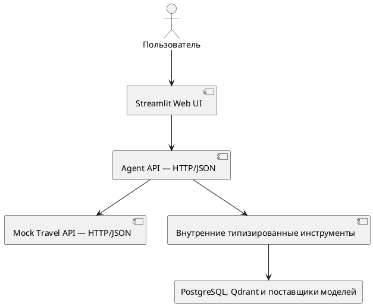

# API и контракты инструментов Travel Policy Copilot

**Проект:** Travel Policy Copilot  
**Целевая инициатива:** Travel AI Platform  
**Тип документа:** архитектура API, OpenAPI и внутренние контракты инструментов 

---

## 1. Назначение документа

Документ фиксирует контрактную архитектуру Travel Policy Copilot:

- публичный HTTP API агента;
- сеанс с сохранением состояния и протокол действий;
- HTTP API демонстрационного поставщика вариантов поездки (Mock Travel API);
- внутренние контракты инструментов;
- ограничения времени ожидания, повторные попытки и резервные режимы;

Машиночитаемыми контрактами являются:

- `agent-api-openapi.yaml`;
- `mock-travel-api-openapi.yaml`.
  
---

## 2. Контрактные границы



| Граница | Контракт | Статус |
|---|---|---|
| Браузер / UI → Agent API | OpenAPI `agent-api-openapi.yaml` | Публичный контракт MVP |
| Agent API → Mock Travel API | OpenAPI `mock-travel-api-openapi.yaml` | Граница взаимодействия с поставщиком вариантов поездки |
| Узлы LangGraph → инструменты | Типизированные модели запросов и ответов | Внутренний контракт приложения |
| Инструменты → PostgreSQL/Qdrant/RouterAI | Контракты адаптеров и поставщиков | Инфраструктурный контракт; отдельной спецификации OpenAPI нет |
| Agent API → Langfuse | Контракт SDK и событий | Передача данных наблюдения без влияния на основную операцию |

Интерфейс взаимодействует только с Agent API и не обращается напрямую к PostgreSQL, Qdrant, языковой модели или внутренним инструментам.

---

## 3. Сводный каталог Agent API

| Маршрут                                   | Метод | Назначение                                      | Запрос                                                                     | Успешный ответ              | Основные ошибки                   |
| ----------------------------------------- | ----- | ----------------------------------------------- | -------------------------------------------------------------------------- | --------------------------- | --------------------------------- |
| `/health`                                 | GET   | Проверка работы процесса                        | —                                                                          | `200 object<string,string>` | Не заявлены                       |
| `/ready`                                  | GET   | Проверка обязательных зависимостей              | —                                                                          | `200 object`                | `503 HTTPError` в режиме `strict` |
| `/v1/agent/message`                       | POST  | Отправка отдельного сообщения для совместимости | `AgentMessageRequest`                                                      | `200 AgentMessageResponse`  | 400, 403, 422                     |
| `/v1/agent/sessions`                      | POST  | Создание сеанса с сохранением состояния         | `AgentSessionStartRequest`                                                 | `200 AgentSessionResponse`  | 400, 403, 422                     |
| `/v1/agent/sessions/{session_id}`         | GET   | Получение текущего состояния                    | Идентификатор сеанса в пути и идентификатор сотрудника в параметре запроса | `200 AgentSessionResponse`  | 403, 404, 422                     |
| `/v1/agent/sessions/{session_id}/actions` | POST  | Продолжение сеанса                              | `AgentSessionActionRequest`                                                | `200 AgentSessionResponse`  | 400, 403, 404, 422                |

Основной сценарий взаимодействия с API использует сеанс с сохранением состояния. Маршрут `/v1/agent/message` принимает отдельное сообщение и не поддерживает полный протокол продолжения сценария с участием человека (HITL).

---

## 4. Контракты проверки работоспособности и готовности

### 4.1. `/health`

Назначение — подтвердить, что процесс Agent API отвечает. Контракт не гарантирует доступность PostgreSQL, Qdrant, Mock Travel API или внешних поставщиков моделей.

```json
{
  "status": "ok",
  "environment": "local",
  "backend_mode": "strict"
}
```

### 4.2. `/ready`

Назначение — проверить обязательные зависимости. В режиме `strict` недоступность обязательной зависимости приводит к `503`.

```json
{
  "status": "ready",
  "dependencies": {
    "postgresql": "ready",
    "qdrant": "ready",
    "mock_travel_api": "ready"
  }
}
```


### 4.3. Смысл проверок

| Проверка | На какой вопрос отвечает | Чего не подтверждает |
|---|---|---|
| Проверка работы процесса `/health` | Отвечает ли HTTP-процесс? | Готовность принимать запросы пользователей |
| Проверка готовности `/ready` | Доступны ли обязательные внешние службы в текущем режиме? | Функциональную корректность полного сценария |

---

## 5. Контракт отправки отдельного сообщения

### 5.1. Запрос `/v1/agent/message`

`AgentMessageRequest`:

| Поле | Тип | Ограничения | Обязательное |
|---|---|---|---|
| `employee_id` | string | minLength 3 | Да |
| `message` | string | От 1 до 4000 символов | Да |

```json
{
  "employee_id": "EMP-001",
  "message": "Нужна командировка из Уфы в Москву 10–12 октября"
}
```

### 5.2. Ответ

`AgentMessageResponse` содержит:

| Поле | Тип | Обязательное | Семантика |
|---|---|---|---|
| `trace_id` | string | Да | Идентификатор для связывания событий |
| `current_step` | string | Да | Текущий этап сценария |
| `missing_fields` | string[] | Да | Недостающие параметры |
| `answer` | string | Да | Пользовательский ответ |
| `travel_search_outcome` | string/null | Нет | Результат обращения к поставщику |
| `travel_search_error_code` | string/null | Нет | Нормализованный код ошибки поставщика |
| `recovery_advice` | string/null | Нет | Подсказка для восстановления |
| `backend_status` | string | Нет, значение по умолчанию — `healthy` | Состояние обслуживающих компонентов |
| `degraded_components` | string[] | Нет | Компоненты в резервном режиме или с ограничениями |

Маршрут `/v1/agent/message` не возвращает идентификатор сеанса, рекомендации, перечень доступных действий, события аудита и идентификатор заявки на согласование. Поэтому он не покрывает основной сценарий взаимодействия с сохранением состояния.

---

## 6. Создание сеанса с сохранением состояния

### 6.1. Запрос `/v1/agent/sessions`

`AgentSessionStartRequest` совпадает по структуре с `AgentMessageRequest`:

```json
{
  "employee_id": "EMP-001",
  "message": "Нужна командировка из Уфы в Москву 10–12 октября"
}
```

### 6.2. Структура ответа

`AgentSessionResponse` — основная структура передачи состояния между API и пользовательским интерфейсом.

| Группа | Поля |
|---|---|
| Идентификация и связывание событий | `session_id`, `employee_id`, `trace_id` |
| Сценарий | `current_step`, `available_actions`, `route_transitions` |
| Взаимодействие с пользователем | `answer`, `clarification_question`, `missing_fields` |
| Разобранный запрос | `trip_request` |
| Рекомендации | `recommendations`, `rejected_options`, `selected_option_id` |
| Результат записи | `approval_request_id` |
| Восстановление сценария | `travel_search_outcome`, `travel_search_error_code`, `recovery_advice` |
| Диагностика | `tool_calls`, `tool_events`, `audit_events` |
| Ограниченный режим | `backend_status`, `degraded_components` |
| Ошибка | `error: AgentError/null` |

Обязательны только `session_id`, `employee_id`, `trace_id`, `current_step`, `missing_fields` и `answer`. Для остальных полей предусмотрены значения `null`, значения по умолчанию либо возможность отсутствовать в ответе согласно схеме.

### 6.3. Пример ответа ожидания уточнения

```json
{
  "session_id": "3e78c9d2-90fd-4be1-aabb-9b5ec8557a7f",
  "employee_id": "EMP-001",
  "trace_id": "78285198e71e43a2bc476f039eb68efd",
  "current_step": "ask_clarification",
  "missing_fields": ["return_date"],
  "answer": "Уточните дату возвращения.",
  "clarification_question": "Когда планируется возвращение?",
  "available_actions": ["submit_clarification"],
  "recommendations": [],
  "tool_calls": [],
  "tool_events": [],
  "audit_events": [],
  "backend_status": "healthy",
  "degraded_components": []
}
```

Пример показывает структуру данных, но конкретные идентификаторы, значение `current_step` и состав диагностических полей необходимо проверить при выполнении.

---

## 7. Чтение сеанса

`GET /v1/agent/sessions/{session_id}?employee_id=...`

| Параметр | Расположение | Обязательный | Назначение |
|---|---|---|---|
| `session_id` | Путь | Да | Идентификатор сеанса в памяти процесса |
| `employee_id` | Параметр запроса | Да | Переданный клиентом идентификатор предполагаемого владельца сеанса |

Результаты:

| HTTP | Значение |
|---:|---|
| 200 | Текущий `AgentSessionResponse` |
| 403 | Переданный идентификатор сотрудника не совпадает с владельцем сеанса |
| 404 | Сеанс отсутствует или утрачен после повторного запуска |
| 422 | Некорректная структура параметров |

Проверка равенства идентификаторов в текущей реализации не является полноценной авторизацией: клиент самостоятельно указывает `employee_id`, а аутентификация отсутствует.

---

## 8. Протокол действий в сеансе

### 8.1. Общий запрос

`AgentSessionActionRequest`:

| Поле | Тип | Обязательное по OpenAPI | Семантика |
|---|---|---|---|
| `employee_id` | string, minLength 3 | Да | Переданный клиентом идентификатор предполагаемого владельца |
| `action` | enum из 8 значений | Да | Команда продолжения сценария |
| `trip_request_patch` | `TripRequestPatch/null` | Нет | Уточнение запроса или изменение ограничений |
| `selected_option_id` | string/null | Нет | Выбор рекомендации |

OpenAPI описывает единый объект для всех действий. Условная обязательность данных запроса проверяется кодом приложения и не выражена через `oneOf` и `discriminator`.

### 8.2. Нормативная матрица состояний и действий

Матрица объединяет значения `enum` из OpenAPI и сведения о выполнении сценария. Она задаёт ожидаемые ограничения протокола; наличие проверки действия до возобновления графа необходимо подтвердить и при необходимости реализовать.

| Действие | Допустимое состояние ожидания | Обязательные данные | Ожидаемый переход | Запись разрешена |
|---|---|---|---|---:|
| `submit_clarification` | Ожидание уточнения | Непустой `trip_request_patch` | Объединить данные → проверить запрос | Нет |
| `update_constraints` | Нет вариантов / восстановление после отказа поставщика | Непустой `trip_request_patch` | Объединить данные → проверить запрос | Нет |
| `retry_search` | Нет вариантов / восстановление после отказа поставщика | Дополнительные данные не требуются | Повторить поиск с текущими ограничениями | Нет |
| `cancel` | Восстановление сценария | Дополнительные данные не требуются | Завершить с отменой | Нет |
| `select_option` | Ожидание выбора рекомендации | `selected_option_id` | Проверить выбранный вариант → запросить подтверждение | Нет |
| `confirm` | Ожидание подтверждения | Дополнительные данные не требуются | Повторная проверка → идемпотентная запись | Да |
| `reject` | Ожидание подтверждения | Дополнительные данные не требуются | Завершить с отказом | Нет |
| `change_selection` | Ожидание подтверждения | Дополнительные данные не требуются | Вернуться к рекомендациям | Нет |

### 8.4. Примеры запросов

Уточнение запроса:

```json
{
  "employee_id": "EMP-001",
  "action": "submit_clarification",
  "trip_request_patch": {
    "return_date": "2026-10-12"
  }
}
```

Выбор варианта:

```json
{
  "employee_id": "EMP-001",
  "action": "select_option",
  "selected_option_id": "OPT-FLIGHT-001"
}
```

Подтверждение:

```json
{
  "employee_id": "EMP-001",
  "action": "confirm"
}
```

---

## 9. Контракты запроса на поездку

### 9.1. `TripRequest`

| Поле | Тип | Ограничение или значение по умолчанию |
|---|---|---|
| `origin_city` | string/null | Необязательно |
| `destination_city` | string/null | Необязательно |
| `departure_date` | date/null | Необязательно |
| `return_date` | date/null | Необязательно; проверка предметной области требует дату не раньше даты отправления |
| `meeting_datetime` | date-time/null | Необязательно |
| `earliest_departure_hour` | integer/null | 0–23 |
| `latest_arrival_hour` | integer/null | 0–23 |
| `max_segments` | integer/null | 1–4 |
| `disallowed_time_windows` | string[] | Массив |
| `transport_preferences` | string[] | Массив; допустимые значения не закреплены в схеме Agent API |
| `hotel_required` | boolean | По умолчанию `true` |
| `comment` | string/null | Необязательно |

OpenAPI не помечает поля `TripRequest` обязательными, потому что модель используется для поэтапного заполнения и уточнения запроса. Полнота данных для выполнения сценария определяется проверками, а не только JSON Schema.

### 9.2. `TripRequestPatch`

`TripRequestPatch` повторяет поля `TripRequest`, но поля списков и логические поля также допускают `null`. В текущей реализации данные объединяются средствами приложения; формат не соответствует JSON Merge Patch (RFC 7396).

Контракт должен различать:

- поле отсутствует — оставить текущее значение;
- поле передано как `null` — очистить либо проигнорировать в соответствии с реализованным правилом объединения;
- пустой список — заменить текущий список пустым.

---

## 10. Контракты рекомендаций и ссылок на источники

### 10.1. `Recommendation`

| Поле | Тип | Обязательное |
|---|---|---:|
| `option_id` | string | Да |
| `score_total` | number | Да |
| `score_price` | number | Да |
| `score_schedule` | number | Да |
| `score_preference` | number | Да |
| `score_policy` | number | Да |
| `is_recommended` | boolean | Да |
| `explanation` | string | Да |
| `policy_summary` | string | Да |
| `budget_summary` | string | Да |
| `citations` | `PolicyChunkRef[]` | Нет; по умолчанию — пустой массив |

Оценки рассчитываются детерминированным кодом приложения. Поле `explanation` может формироваться языковой моделью; при её недоступности приложение составляет объяснение по заданным правилам.

### 10.2. `PolicyChunkRef`

Обязательные: `document_id`, `section_id`, `source_path`, `score`.

Дополнительные поля: название документа, версия правил, название раздела, дата вступления в силу, категория сотрудника, тип правила и текст фрагмента.

Архитектурное правило: структурированная ссылка на источник формируется из данных поиска, а не из свободного текста LLM.

### 10.3. Пример рекомендации

```json
{
  "option_id": "OPT-FLIGHT-001",
  "score_total": 0.87,
  "score_price": 0.92,
  "score_schedule": 0.84,
  "score_preference": 1.0,
  "score_policy": 0.75,
  "is_recommended": true,
  "explanation": "Вариант соответствует ограничениям и имеет лучший итоговый балл.",
  "policy_summary": "Требования к классу и времени отправления соблюдены.",
  "budget_summary": "Стоимость находится в пределах лимита.",
  "citations": [
    {
      "document_id": "POLICY-TRANSPORT",
      "section_id": "POLICY-TRANSPORT-S01-C0001",
      "source_path": "data/policies/transport_policy.md",
      "score": 0.91,
      "policy_version": "v0.2"
    }
  ]
}
```

---

## 11. Ошибки Agent API

### 11.1. Структуры ошибок HTTP

`HTTPError`:

```json
{
  "detail": "Session was not found"
}
```

Поле `detail` допускает строку (`string`) или произвольный объект (`object`). При ошибке проверки входных данных FastAPI возвращает `HTTPValidationError` с массивом `ValidationError`.

### 11.2. Классификация статусов HTTP

| HTTP | Категория | Примеры |
|---:|---|---|
| 200 | Маршрут выполнен; в теле ответа возможны ожидание, восстановление и ошибка | Сеанс создан или возобновлён; вложенная ошибка `AgentError` |
| 400 | Некорректный ввод или действие | Превышение длины сообщения, неполные данные действия, неподдерживаемое действие |
| 403 | Отказ в доступе к сеансу или профилю | Несовпадение идентификаторов сотрудника или отказ в доступе к профилю |
| 404 | Ресурс отсутствует | Сеанс не найден |
| 422 | Ошибка проверки схемы | Отсутствующее или некорректное поле, нарушение диапазона или набора допустимых значений |
| 503 | Недоступна обязательная зависимость | Вызов `/ready` в режиме `strict` |

### 11.3. Вложенная прикладная ошибка

`AgentError`:

| Поле | Тип | Обязательное | Значение |
|---|---|---:|---|
| `code` | string | Да | Предполагаемый стабильный код ошибки предметной области |
| `message` | string | Да | Сообщение, безопасное для передачи клиенту |
| `retryable` | boolean | Нет, по умолчанию `false` | Допустимость повторной попытки |

Успешный ответ HTTP не гарантирует завершения бизнес-сценария: `200 AgentSessionResponse` может содержать `error`, результат восстановления или состояние ожидания. Клиент обязан интерпретировать `current_step`, `available_actions` и `error`, а не только код ответа HTTP.

### 11.4. Рекомендуемая единая классификация для пилотной эксплуатации

| Категория | Пример кода | HTTP |
|---|---|---:|
| Проверка данных | `INVALID_REQUEST` | 400/422 |
| Идентификация и доступ | `SESSION_ACCESS_DENIED` | 403 |
| Ресурс | `SESSION_NOT_FOUND` | 404 |
| Конфликт состояния | `ACTION_NOT_ALLOWED_IN_STATE` | 409 |
| Зависимость | `TRAVEL_SUPPLIER_UNAVAILABLE`, `RAG_UNAVAILABLE` | 502/503 либо ответ 200 с предложением восстановить сценарий согласно принятому контракту |
| Превышение времени ожидания | `TRAVEL_SUPPLIER_TIMEOUT`, `LLM_TIMEOUT` | 504 либо 200 с предложением восстановить сценарий |
| Конфликт записи и идемпотентность | `DUPLICATE_REQUEST` | 200 с прежним результатом либо 409 |
| Внутренняя ошибка | `INTERNAL_ERROR` | 500 |

В MVP допускается сочетать ошибки HTTP и ошибки предметной области, если клиентские приложения различают их, а проверки охватывают оба вида.

---

## 12. Mock Travel API

### 12.1. Каталог методов API

| Маршрут              | Метод | Запрос                       | Успешный ответ                       | Ошибки        |
| -------------------- | ----- | ---------------------------- | ------------------------------------ | ------------- |
| `/health`            | GET   | —                            | `200 object<string,string\|integer>` | Не заявлены   |
| `/v1/options/search` | POST  | `TravelOptionsSearchRequest` | `200 TravelOptionsSearchResponse`    | 422, 503, 504 |

### 12.2. Поисковый запрос

Обязательные поля:

- `origin_city`, minLength 2;
- `destination_city`, minLength 2;
- `departure_date`;
- `return_date`.

Дополнительные поля:

| Поле | Тип и ограничение |
|---|---|
| `meeting_datetime` | date-time/null |
| `earliest_departure_hour` | integer 0–23/null |
| `latest_arrival_hour` | integer 0–23/null |
| `disallowed_time_windows` | string[] |
| `transport_preferences` | Массив значений `enum`: `flight`/`train` |
| `max_segments` | integer 1–4/null |
| `allowed_fare_classes` | economy/premium_economy/business[] |
| `hotel_required` | boolean, по умолчанию `true` |
| `accessibility_requirements` | string[] |
| `scenario_mode` | `normal`/`empty`/`error_4xx`/`error_5xx`/`timeout`; по умолчанию `normal` |
| `timeout_seconds` | number 0.1–10/null |

```json
{
  "origin_city": "Уфа",
  "destination_city": "Москва",
  "departure_date": "2026-10-10",
  "return_date": "2026-10-12",
  "transport_preferences": ["flight"],
  "max_segments": 1,
  "allowed_fare_classes": ["economy"],
  "hotel_required": true,
  "accessibility_requirements": [],
  "scenario_mode": "normal"
}
```

### 12.3. Ответ на поисковый запрос

`TravelOptionsSearchResponse`:

| Поле | Тип | Обязательное |
|---|---|---:|
| `search_id` | string | Да |
| `currency` | Постоянное значение `RUB`; по умолчанию `RUB` | Нет |
| `total_options` | integer | Да |
| `options` | `TravelOffer[]` | Да |

`TravelOffer` содержит идентификатор варианта, вид транспорта, пункты отправления и прибытия, даты и время поездки в обе стороны, перевозчика, класс тарифа, необязательные сведения об отеле, валюту RUB, общую стоимость, число участков маршрута и признак возможности возврата.

### 12.4. Управляемые сценарии поставщика

| `scenario_mode` | HTTP | Ответ поставщика | Обработка агентом |
|---|---:|---|---|
| `normal` | 200 | Предложения | Перейти к поиску правил и их проверке |
| `empty` | 200 | `total_options=0`, пустой массив | Предложить изменить условия поиска |
| `error_4xx` | 422 | `HTTPError` | Обработать некорректный запрос поставщику и предложить восстановить сценарий |
| `error_5xx` | 503 | `HTTPError` | Обработать отказ поставщика с возможностью повторной попытки |
| `timeout` | 504 либо более раннее превышение времени ожидания у клиента | `HTTPError` или превышение времени ожидания | Предложить повторную попытку |

Ответ Mock Travel API с кодом `422` описан через `oneOf`: это ошибка проверки данных FastAPI либо специально сформированная `HTTPError`. Клиент должен обрабатывать обе формы.

---

## 13. Граница внутренних инструментов

Внутренние инструменты выбираются из фиксированного перечня, их вызовы выполняются явным образом, произвольное выполнение функций не предусмотрено.

| Инструмент | Вид операции | Вызывающий узел | Обслуживающий компонент | Основной контракт |
|---|---|---|---|---|
| `get_employee_profile` | Чтение | Узел `get_employee_profile` | PostgreSQL или резервный вариант согласно режиму | Идентификатор сотрудника → типизированный профиль или ошибка |
| `search_travel_options` | Чтение | Узел поиска | Mock Travel API по HTTP | Ограничения поездки и профиля → типизированные варианты или результат поиска |
| `retrieve_travel_policy` | Чтение | Узел поиска правил | API векторизации и Qdrant | Запрос и профиль → фрагменты правил, диагностические данные или ошибка |
| `check_budget` | Вычисление и чтение | Узел проверки бюджета | Детерминированный код приложения | Лимит сотрудника и стоимость → результат проверки |
| `create_approval_request` | Запись | Узел записи после подтверждения | PostgreSQL или память процесса вне режима `strict` | Подтверждённый черновик → постоянный идентификатор заявки |

## 14. Контракты инструментов

### 14.1. `get_employee_profile`

| Часть контракта | Значение |
|---|---|
| Вход | `employee_id` и контекст инструмента |
| Успех | `EmployeeProfile`: категория сотрудника, центр затрат, уровень должности, базовый город, уровень правил поездок, денежные лимиты, предельный класс тарифа и требования к доступной среде |
| Ошибки | Профиль не найден; отказ в доступе; БД недоступна |
| Режим `strict` | Отказ PostgreSQL обрабатывается без скрытого перехода в резервный режим |
| Остальные режимы | Допускается явно обозначенный резервный профиль |

### 14.2. `search_travel_options`

| Часть контракта | Значение |
|---|---|
| Вход | Полный `TripRequest`, а также вычисленные допустимые классы тарифа, специальные потребности и параметры сценария |
| Внешний вызов | `POST /v1/options/search` |
| Успех | Типизированные варианты поездки и `search_id` поставщика |
| Пустой результат | Результат предметной области `options_not_found`, а не ошибка успешного запроса |
| Ошибки | Ответы 4xx/5xx, превышение времени ожидания и недоступность преобразуются в ошибку обращения к поставщику |
| Время ожидания и повторы | По умолчанию 8 с; в текущей реализации нет цикла автоматических повторов в приложении |

### 14.3. `retrieve_travel_policy`

| Часть контракта | Значение |
|---|---|
| Вход | Поисковый запрос, `EmployeeProfile` или категория сотрудника, контекст инструмента |
| Успех | `PolicyChunkRef[]` и сведения о поиске и векторизации |
| Фильтры | Версии корпуса и правил, категория сотрудника, исключение тестового корпуса для проверки безопасности |
| Ошибка в режиме `strict` | Контролируемая ошибка `RAG_UNAVAILABLE`; локальное хранилище или модель векторизации не подставляются |
| Остальные режимы | Возможны локальный индекс и упрощённая векторизация; ограниченный режим должен быть обозначен |

### 14.4. `check_budget`

| Часть контракта | Значение |
|---|---|
| Вход | Лимит из профиля сотрудника и общая стоимость варианта |
| Успех | `BudgetCheckResult`: результат проверки, стоимость, порог и превышение; валюта RUB подразумевается |
| Поведение | Детерминированный расчёт без внешнего вызова; языковая модель не может изменить результат |
| Ошибка | Стоимость или данные профиля отсутствуют либо некорректны |

### 14.5. `create_approval_request`

| Часть контракта | Значение |
|---|---|
| Условия выполнения | Действующий сеанс, выбранный вариант входит в список рекомендаций, есть явное подтверждение и выполнены требования правил поездок |
| Вход | Снимок `ApprovalRequest`, ключ идемпотентности и контекст |
| Успех | Неизменный `approval_request_id` и признак создания новой либо возврата существующей заявки |
| Повтор | Вернуть существующий идентификатор заявки |
| Режим `strict` | Только PostgreSQL |
| Остальные режимы | Допускается хранилище в памяти процесса без гарантии сохранности |
| Инвариант ошибки | Ошибка не должна приводить к ложному сообщению об успехе или повторной записи |

---

## 15. Контракты времени ожидания, повторных попыток и резервного режима

| Граница | Время ожидания и повторы в текущей реализации | Резервное поведение | Примечание |
|---|---|---|---|
| Языковая модель | 20 с, две повторные попытки SDK | Детерминированный разбор, вопросы и объяснения даже в режиме `strict` | Формальные результаты проверки не меняются |
| Векторизация текста | 8 с, без повторных попыток | Локальная упрощённая векторизация только вне режима `strict` | В режиме `strict` поиск правил завершается контролируемой ошибкой |
| Mock Travel API | 8 с, без цикла повторов в клиенте | Ветка восстановления сценария | Повтор запускается действием пользователя |
| PostgreSQL | Ограничено время подключения и запроса; собственных повторов нет | Резервный профиль и хранилище заявок допустимы только вне режима `strict` | Повторная запись защищена ключом идемпотентности |
| Qdrant | Время ожидания определяется настройками клиента | Локальный индекс только вне режима `strict` | В режиме `strict` возвращается контролируемая ошибка |
| Langfuse | Передача данных по возможности | Сбор данных наблюдения может быть отключён | Результат сценария не меняется |

Контракт должен отличать **повтор той же операции** от **возобновления пользовательского сценария**. Например, `retry_search` является действием пользователя, а не автоматическим повтором HTTP-запроса.

---
