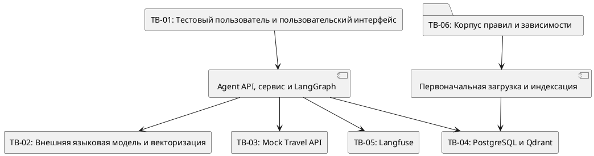
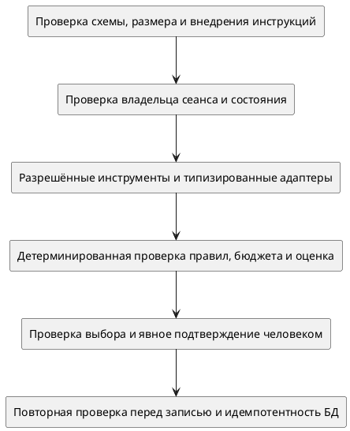

# Архитектура безопасности Travel Policy Copilot

**Проект:** Travel Policy Copilot  
**Целевая инициатива:** Travel AI Platform  
**Тип документа:** архитектура безопасности, модель угроз и матрица мер защиты  

---

## 1. Назначение документа

Документ определяет архитектуру безопасности Travel Policy Copilot:

- защищаемые активы и цели безопасности;
- акторов, предположения и границы доверия;
- поверхность атаки API, сценария агента, LLM, RAG, инструментов, данных и системы наблюдения;
- угрозы, связанные с идентификацией, состоянием, контекстом ИИ, записью, данными и цепочкой поставки;
- реализованные меры защиты.

---

## 3. Границы анализа безопасности и допустимый контекст эксплуатации

### 3.1. Защищаемый контур

В анализ безопасности входят:

- пользовательский интерфейс и Agent API;
- хранилище сеансов, контрольная точка LangGraph и состояние сценария;
- шлюз языковой модели и вызовы модели векторизации;
- фиксированный набор инструментов и инфраструктурные адаптеры;
- компоненты Policy Engine, Budget Check и Recommendation Scoring;
- PostgreSQL, Qdrant и корпуса правил поездок;
- Mock Travel API;
- Langfuse и передаваемые данные наблюдения;
- начальная загрузка, конфигурация, зависимости и граница Docker Compose.

### 3.2. Контекст, в котором допустима текущая реализация

Текущая реализация рассчитана только на локальный учебный MVP при следующих условиях:

1. приложение не публикуется в недоверенную сеть;
2. оператор хоста и среда Docker Compose считаются доверенными;
3. используются синтетические профили, корпуса правил поездок и предложения для поездок;
4. пользователь демонстрационного интерфейса не считается аутентифицированным корпоративным субъектом;
5. создание `approval_request` означает подготовку учебного черновика, а не реальное бронирование, платёж или согласование в BPM-системе;
6. стандартные локальные учётные данные и открытые порты среды разработки не используются при пилотной эксплуатации;

### 3.3. Вне текущих границ анализа безопасности

- защита действующих систем управления персоналом (HR), ресурсов предприятия (ERP), бизнес-процессов (BPM) и систем поставщиков;
- платёжных данных и данных банковских карт;
- обслуживание нескольких организаций в промышленной среде;
- физическая безопасность и корпоративные процессы работы центра мониторинга безопасности;
- защита инфраструктуры Kubernetes и сервисной сети (service mesh), обеспечение высокой доступности и восстановление после аварий;

---

## 4. Цели безопасности и инварианты

| ID      | Инвариант                                                  | Требуемый результат                                                                                                             |
| ------- | ---------------------------------------------------------- | ------------------------------------------------------------------------------------------------------------------------------- |
| `SI-01` | LLM и найденный текст не обладают правом принимать решения | Они не могут менять формальное решение по правилам и бюджету, выбирать произвольный инструмент или разрешать запись             |
| `SI-02` | Запись требует явного подтверждения человеком              | `approval_request` недостижим без выбранного актуального варианта и состояния `confirmed`                                       |
| `SI-03` | Повтор не создаёт повторную запись                         | Детерминированный ключ и ограничение уникальности в БД возвращают стабильный результат                                          |
| `SI-04` | Набор разрешённых возможностей фиксирован                  | Агент не выполняет произвольные URL, SQL, команды оболочки, произвольный код или переданные извне функции                       |
| `SI-05` | Критически важные входные данные типизированы              | Некорректные данные запроса, инструмента или предметной области отклоняются до внешнего вызова или записи                       |
| `SI-06` | Режим `strict` не скрывает отказ обязательной службы       | Ошибка PostgreSQL, Qdrant или сервиса векторизации приводит к контролируемому отказу без незаметного перехода в резервный режим |
| `SI-07` | Данные наблюдения не влияют на решение                     | Отказ или ответ Langfuse не меняет данные приложения и решение о записи                                                         |
| `SI-08` | Секреты не входят в данные сценария                        | Ключи и пароли не попадают в репозиторий, запросы к модели, публичные ответы и записи выполнения                                |
| `SI-09` | Выбор тестового сотрудника не выдаётся за IAM              | Указанный клиентом `employee_id` описывается как ограничение, а не аутентификация                                               |

---

## 5. Активы и требования безопасности

| Актив | Конфиденциальность | Целостность | Доступность | Основная угроза |
|---|---:|---:|---:|---|
| Профиль сотрудника и сведения об особых потребностях | Высокая для пилотной эксплуатации | Высокая | Средняя | Доступ к чужому профилю, избыточная передача и утечка через трассировку |
| Запрос поездки и текст пользователя | Высокая для пилотной эксплуатации | Высокая | Средняя | Передача модели и поставщику, внедрение инструкций, неопределённый срок хранения |
| Корпус правил и метаданные | Средняя | Высокая | Высокая | Подмена или устаревание правил, вредоносные фрагменты |
| Индекс Qdrant | Средняя | Высокая | Высокая | Подмена данных, расхождение версий и недоступность поиска |
| Результаты проверки правил и бюджета | Средняя | Критическая | Высокая | Подмена решения моделью, устаревшие правила или изменённый вариант |
| Рекомендация и выбранный вариант | Средняя | Высокая | Средняя | Подмена варианта, устаревшее или параллельное действие |
| Сеанс, контрольная точка и допустимые действия | Высокая для пилотной эксплуатации | Критическая | Высокая | Перехват сеанса, повтор действия, параллельные переходы и потеря состояния при перезапуске |
| Черновик заявки и ключ идемпотентности | Высокая | Критическая | Высокая | Несанкционированная или повторная запись, неполные данные аудита |
| Учётные данные API, языковой модели и Langfuse | Критическая | Критическая | Высокая | Утечка через репозиторий или журналы, небезопасные стандартные значения |
| Записи выполнения, запросы к модели и события аудита | Высокая | Высокая | Средняя | Утечка персональных данных и секретов, подмена и неполная история событий |
| Конфигурация, образы и зависимости | Средняя | Критическая | Высокая | Изменение состава поставки и вредоносные пакеты или образы |

---

## 6. Акторы и модель нарушителя

| Участник | Степень доверия в текущей реализации | Возможности и риски |
|---|---|---|
| Тестовый пользователь | Частично доверенный | Может отправлять произвольный текст, идентификатор сотрудника и данные действия |
| Пользовательский интерфейс | Доверенный клиент только в локальном контуре | Не является границей безопасности: API можно вызвать без интерфейса |
| Локальный оператор | Доверенный | Имеет доступ к окружению, портам, томам и локальным учётным данным |
| Поставщик языковой модели и сервиса векторизации | Внешняя сторона, которой передаются данные на обработку | Получает запросы к модели и фрагменты корпуса; может вернуть ошибочный или небезопасный ответ либо ответить с задержкой |
| Mock Travel API | Логически внешняя система | Может вернуть ошибочный, подменённый или чрезмерный объём данных |
| Автор или источник документа правил | Доверие должно быть установлено | Может внести устаревший или вредоносный текст, похожий на инструкции |
| Langfuse | Вспомогательная система без права принимать решения | Получает данные наблюдения; при компрометации могут раскрыться запросы к модели и состояние сценария |
| Поставщик пакета или образа | Внешняя граница цепочки поставки | Компрометация пакета или образа меняет поведение приложения при выполнении |
| Нарушитель в сети | Риск снижен предположением о локальном запуске | Становится значимым при открытии портов или удалённом развёртывании |

---

## 7. Границы доверия

| Граница                                      | Передаваемые данные                                                                           | Меры в текущей реализации                                                                    |
| -------------------------------------------- | --------------------------------------------------------------------------------------------- | -------------------------------------------------------------------------------------------- |
| `TB-01` Пользователь и интерфейс → API       | Текст, идентификаторы сотрудника и сеанса, действие и его данные                              | Pydantic, ограничение длины и сравнение идентификатора сотрудника в сеансе                   |
| `TB-02` API → языковая модель и векторизация | Запросы к модели, текст пользователя, параметры поездки, поисковые запросы и фрагменты правил | Разделение сообщений, типизированный разбор, ограничение времени ожидания и очистка секретов |
| `TB-03` API → поставщик вариантов поездки    | Ограничения поездки и возвращаемые предложения                                                | Заданный адрес, типизированные запросы и ответы, ограничение времени ожидания                |
| `TB-04` API → хранилища                      | Профили, черновики, векторы и метаданные                                                      | Хранилища и адаптеры, ограничения БД, контролируемый отказ в режиме `strict`                 |
| `TB-05` API → Langfuse                       | Запросы к модели, этапы трассировки, события, оценки и сведения об использовании              | Очистка данных и необязательная передача по возможности                                      |
| `TB-06` Корпус и зависимости → приложение    | Markdown, пакеты, образы и конфигурация                                                       | Заданные пути, фильтры по метаданным и `.gitignore`                                          |

### 7.1. Важная граница идентичности

`employee_id` передаёт клиент. Сравнение этого значения с идентификатором владельца в записи сеанса помогает избежать случайного смешения данных, но **не является аутентификацией или авторизацией**: клиент самостоятельно сообщает, кем он является. Идентификатор сеанса в формате UUID также не подтверждает личность пользователя.

### 7.2. Логические и физические границы

Mock Travel API и Langfuse могут работать в том же Docker Compose, однако остаются отдельными логическими системами. Совместный узел и общая сеть не делают их ответы и хранилища доверенными внутренними данными.

---

## 8. Перечень поверхностей атаки

| Поверхность атаки | Входные данные или операция | Возможное злоупотребление | Меры контроля в текущей реализации |
|---|---|---|---|
| `POST /v1/agent/message` | Идентификатор сотрудника и сообщение | Подмена личности, слишком длинное сообщение или внедрение инструкций | Pydantic и проверки сервиса |
| `POST /v1/agent/sessions` | Идентификатор сотрудника и сообщение | Массовое создание сеансов и истощение ресурсов | Ограничения входных данных и числа шагов; ограничения частоты запросов нет |
| `GET /sessions/{id}` | Идентификатор сеанса и параметр запроса с идентификатором сотрудника | Перебор сеансов, доступ к чужому состоянию, попадание идентификатора в журналы | UUID и сравнение идентификаторов; аутентификации нет |
| `POST /sessions/{id}/actions` | Действие и зависящие от него данные | Недопустимое, устаревшее или повторное действие; параллельные переходы и подмена варианта | Типизированный `enum` и обработчик; проверка актуального состояния до выполнения неполна |
| Граница инструментов | Пять заранее заданных возможностей | Вызов произвольного инструмента, URL, SQL или кода; вредоносные аргументы | Фиксированный перечень разрешённых инструментов, явная маршрутизация и типизированные контракты |
| Ответ языковой модели | Разобранный запрос на поездку и объяснение | Внедрение инструкций, некорректный ответ или вымышленные сведения | JSON и Pydantic для запроса на поездку; критические решения принимаются детерминированно |
| Фрагменты RAG | Найденный текст правил | Косвенное внедрение инструкций, подмена данных и устаревшие правила | Исключение тестового корпуса, очистка текста и детерминированный Policy Engine |
| Ответ поставщика | Варианты поездки и ошибки | Подмена цены или варианта, чрезмерный объём ответа, смысловые противоречия | Типизированная модель и проверка принадлежности варианта; подлинность не подтверждена |
| Подтверждение и запись | Выбранный вариант и состояние | Несанкционированная или повторная запись | Остановка сценария для подтверждения, проверки повторов, UUID5 и ограничение уникальности в БД |
| PostgreSQL и Qdrant | Локальные протоколы | Несанкционированный доступ, повреждение или раскрытие данных | Учётные данные и сеть Compose; меры для промышленной эксплуатации не подтверждены |
| Langfuse | Приём событий и трассировок, пользовательский интерфейс | Утечка чувствительных данных, поддельные или отсутствующие записи | Очистка данных и независимость от результата основного сценария |
| Первоначальная загрузка и индексация | Корпус, миграции и внешний сервис векторизации | Подмена корпуса, разрушительное перестроение индекса или компрометация зависимости | Детерминированные идентификаторы и конфигурация; происхождение и проверка состава не подтверждены |

---

## 9. Последовательность проверок безопасности

---

## 10. Модель угроз и матрица мер защиты

Оценка риска носит качественный характер. Столбец «Влияние» отражает последствия при возможной пилотной эксплуатации, а «Остаточный риск» учитывает имеющиеся меры и ограничения локального MVP.

| ID     | Угроза и граница                                                                           | Влияние                                                                       | Мера в текущей реализации и подтверждение                                                                              |
| ------ | ------------------------------------------------------------------------------------------ | ----------------------------------------------------------------------------- | ---------------------------------------------------------------------------------------------------------------------- |
| `T-01` | Подмена личности сотрудника через `TB-01`                                                  | Доступ к чужому профилю или черновику                                         | Проверка совпадения идентификаторов сотрудника в сеансе; в исходном коде есть тест доступа                             |
| `T-02` | Чтение или изменение чужого сеанса                                                         | Раскрытие данных и переход без разрешения                                     | UUID сеанса и проверка принадлежности сотруднику                                                                       |
| `T-03` | Недопустимое, устаревшее или одновременное действие                                        | Неверный переход и обход логики                                               | Ограниченные значения действий, переходы графа и перечень действий в ответе                                            |
| `T-04` | Запись без подтверждения                                                                   | Несанкционированный черновик заявки                                           | Прерывание графа, проверки узла и инструмента, проверка варианта                                                       |
| `T-05` | Повторная или одновременная запись                                                         | Дубликаты или неоднозначный результат                                         | Ключ UUID5, `UNIQUE(idempotency_key)`, чтение существующей записи при конфликте                                        |
| `T-06` | Произвольный инструмент, URL, SQL или выполнение кода                                      | Удалённое выполнение кода, запросы во внутреннюю сеть и потеря данных         | Пять инструментов, явное направление вызовов, типизированные контракты и заданные адреса                               |
| `T-07` | Прямое внедрение инструкций                                                                | Искажение сценария или ответа                                                 | Поиск опасных фраз на русском и английском языках, отметка аудита, структурированный разбор и детерминированная логика |
| `T-08` | Внедрение инструкций через найденные документы                                             | Вредоносные инструкции в контексте и утечка данных                            | Исключение `security_test`, удаление подозрительных строк; найденный текст не даёт права на запись                     |
| `T-09` | Языковая модель меняет результат проверки правил или бюджета                               | Неверное одобрение или рекомендация                                           | Проверки правил и бюджета, расчёт оценок и ссылки на источники отделены от языковой модели                             |
| `T-10` | Утечка персональных или конфиденциальных данных в языковую модель либо сервис векторизации | Нарушение требований к конфиденциальности или договора                        | Структурированные запросы к модели и предположение о синтетических данных                                              |
| `T-11` | Утечка чувствительных данных через журналы, Langfuse или диагностику API                   | Раскрытие через данные наблюдения и диагностики                               | Очистка полей и значений, похожих на секреты; Langfuse не обязателен                                                   |
| `T-12` | Утечка секретов                                                                            | Компрометация поставщиков моделей и хранилищ                                  | Настройки среды, исключение `.env` из Git и очистка значений, похожих на секреты                                       |
| `T-13` | Чрезмерный запрос, массовое создание сеансов или зацикливание графа                        | Истощение ресурсов или отказ в обслуживании                                   | Ограничение сообщения до 4000 символов, настраиваемый предел сервиса, не более 12 шагов и ограничения времени ожидания |
| `T-14` | Ошибочный или вредоносный ответ поставщика                                                 | Подмена цены, маршрута или варианта                                           | Типизированный ответ, проверка принадлежности варианта и детерминированные проверки                                    |
| `T-15` | Устаревшие или подменённые правила                                                         | Неверное решение по устаревшим правилам                                       | Фильтры по версии и категории, структурированные ссылки на источники и детерминированные идентификаторы                |
| `T-16` | Подделка или отсутствие истории аудита                                                     | Невозможно восстановить историю действий и записи                             | События аудита в памяти процесса, необязательные трассировки и черновик заявки в БД                                    |
| `T-17` | Подмена зависимости или контейнерного образа                                               | Выполнение вредоносного кода или изменение состава сборки                     | Имеются перечни зависимостей и файлы Docker Compose                                                                    |
| `T-18` | Доступ к локальным портам и стандартным учётным данным извне                               | Компрометация хранилищ или интерфейса                                         | Предположение об изолированной локальной среде Docker Compose                                                          |
| `T-19` | Отказ или подмена Langfuse искажает подтверждающие материалы                               | Потеря диагностики или ложная уверенность                                     | Данные наблюдения передаются по возможности и не влияют на решения                                                     |
| `T-20` | Перезапуск приводит к потере сеансов и контрольных точек                                   | Нарушение целостности или доступности, потеря ожидающего подтверждения сеанса | Ограничение задокументировано; заявка хранится в БД                                                                    |

## 12. Защита агента, инструментов и записи

### 12.1. Граница полномочий

В текущей реализации заявлены пять возможностей:

| Возможность | Тип | Допустимое изменение данных |
|---|---|---|
| `get_employee_profile` | Чтение | Нет |
| `search_travel_options` | Чтение через внешнюю систему | Не изменяет данные приложения |
| `retrieve_travel_policy` | Чтение производных данных | Не изменяет данные приложения |
| `check_budget` | Детерминированный расчёт | Нет |
| `create_approval_request` | Запись | Один черновик заявки после подтверждения; повторы не создают новую запись |

Граница инструментов не должна предоставлять ответу модели доступ к универсальному HTTP-клиенту, исполнению произвольного SQL или команд оболочки, динамической загрузке модулей и вызову функции по имени.

### 12.2. Последовательность разрешения записи

Для разрешения записи одновременно должны выполняться следующие условия:

1. Сеанс существует и принадлежит подтверждённому пользователю либо выбранному для демонстрации сотруднику;
2. Действие допустимо для текущей версии состояния;
3. Выбранный вариант входит в актуальный набор рекомендаций;
4. Правила поездок и условия записи выполнены;
5. пользователь явно подтвердил именно этот выбор;
6. Узел записи повторно проверяет актуальное состояние;
7. Инструмент записи доступен только из узла, получившего подтверждение;
8. ключ идемпотентности детерминирован;
9. Ограничение уникальности в PostgreSQL исключает повторную запись.

### 12.3. Отказ при невозможности проверки

Запись должна быть запрещена в следующих случаях:

- сеанс не найден или утрачен после перезапуска;
- идентификаторы сотрудника и подтверждённого пользователя не совпадают;
- действие недопустимо или относится к устаревшему состоянию;
- выбранный вариант отсутствует или изменился;
- сценарий находится в состоянии отказа (`rejected`), после действий `change_selection` или `cancel` либо в состоянии восстановления;
- произошла ошибка поставщика, поиска правил или получения профиля;
- выявлено нарушение правил, при котором нельзя создать черновик;
- результат проверки данных, преобразования или операции БД неоднозначен;
- превышено допустимое число шагов.

---

## 13. Защита LLM и запросов к ней

### 13.1. Разделение полномочий

| Операция | Полномочия языковой модели |
|---|---|
| Извлечение `TripRequest` | Предложить структуру запроса; результат должен пройти проверку Pydantic и предметных правил |
| Уточнение и объяснение | Сформулировать текст; допускается формирование текста по заданным правилам при недоступности модели |
| Результат проверки правил | Нет |
| Результат проверки бюджета | Нет |
| Оценка рекомендации | Нет |
| Выбор и вызов инструментов | Произвольный выбор не допускается |
| Подтверждение и запись | Нет |

### 13.2. Прямое внедрение инструкций

В текущей реализации регулярные выражения обнаруживают часть русскоязычных и англоязычных попыток переопределить инструкции. Результат отмечается событием аудита; дополнительно применяются структурированный разбор ответа и ограниченный перечень инструментов. Такое сочетание дополняет защиту, но не доказывает, что система безопасно обработает любой вредоносный текст.

Минимальная безопасная реакция:

- не расширять перечень доступных инструментов;
- не включать секреты и внутреннюю конфигурацию в запрос к модели;
- не считать текст модели разрешением на запись;
- проверять структурированный результат и продолжать только по допустимому сценарию;
- при высокой вероятности внедрения инструкций явно отклонять запрос либо запрашивать уточнение.

### 13.3. Проверка результатов

Pydantic и проверка JSON защищают структуру `TripRequest`.

---

## 14. Защита RAG и правил

### 14.1. Меры контроля в текущей реализации

- фильтры по коллекции, версии и категории;
- исключение тестового пространства имён и типа правила `security_test`;
- очистка найденных строк с помощью регулярных выражений;
- ограничение числа фрагментов и объёма контекста;
- формирование структурированного `PolicyChunkRef` из данных Qdrant;
- языковая модель не формирует формальный результат проверки и структурированную ссылку на источник;
- проверка правил и бюджета выполняется детерминированным кодом.

### 14.2. Открытые риски

- проверка косвенного внедрения инструкций основана на эвристиках;
- происхождение корпуса правил не подтверждено владельцем или подписью;
- отсутствуют контрольные суммы исходных документов и индекса;
- `effective_from` хранится, но не участвует в проверке периода действия;
- `effective_to` отсутствует;
- загрузка пересоздаёт коллекцию вместо поэтапного выпуска версии;
- соответствие свободно сформулированного объяснения источникам не подтверждено.

### 14.3. Целевые меры контроля

| Мера контроля | Назначение |
|---|---|
| Реестр утверждённых источников | Загружать документы только от утверждённых владельцев и из установленных источников |
| Контрольная сумма и подпись | Связать исходный документ, фрагменты и версию индекса |
| Период действия | Учитывать `effective_from/effective_to` на дату поездки или принятия решения |
| Уровень доверия к документу | Разделять нормативные, справочные и тестовые материалы |
| Поэтапная смена версии индекса | Проверять новую версию до переключения и сохранять возможность возврата к прежней |
| Проверки RAG на вредоносных примерах | Выявлять скрытые инструкции, подмену корпуса, устаревшие правила и неверные ссылки |
| Проверка обоснованности объяснения | Не допускать объяснений, противоречащих решению или источнику |

---

## 16. Секреты, конфигурация и защита сети

### 16.1. Текущая реализация

- секреты задаются через переменные среды и настройки приложения;
- `.env` исключён из Git;
- `.env.example` содержит примеры значений и стандартные учётные данные для локальной среды;
- Langfuse отключается при отсутствии учётных данных;
- промышленное хранилище секретов, их смена и проверка на утечки не реализованы;
- PostgreSQL, Qdrant, Mock Travel API и Langfuse защищены главным образом локальной сетью Docker Compose и учётными данными;
- наличие промежуточного ПО CORS, завершения TLS и ограничения частоты запросов не подтверждено.

### 16.2. Ограничение границы развёртывания

Порты и локальные учётные данные текущей реализации допустимы только при изоляции среды разработки. Публикация API, PostgreSQL, Qdrant или Langfuse в общей либо публичной сети без дополнительных мер защиты меняет модель угроз.

---

## 23. Итоговая оценка безопасности

### 23.1. Сильные стороны текущей реализации

- Языковая модель отделена от формальных проверок правил и бюджета, расчёта оценок и права на запись;
- фиксированный перечень инструментов и типизированные контракты ограничивают злоупотребление их возможностями;
- пути чтения и записи разделены;
- подтверждение человеком, повторная проверка варианта и идемпотентность образуют несколько уровней защиты;
- ограничены размер входных данных, число шагов и время сетевых вызовов;
- режим `strict` не должен скрывать отказы критически важных хранилищ и сервиса векторизации за резервными компонентами;
- система наблюдения передаёт данные по возможности и не участвует в принятии решений;

### 23.2. Слабые стороны текущей реализации

- отсутствуют аутентификация и управление доступом (IAM);
- идентификатор сотрудника задаётся клиентом;
- проверка допустимости действия и версии состояния неполна;
- сеансы, контрольные точки и события аудита хранятся в памяти процесса;
- правила удаления персональных данных и сроки хранения не определены;
- контроль происхождения и периода действия корпуса правил неполон;
- меры защиты сети, секретов и цепочки поставки не определены.

### 23.3. Архитектурный вывод

Для изолированного учебного MVP риски ограничиваются синтетическими данными и локальным запуском. Перед пилотной эксплуатацией необходимо подтвердить личность пользователя, проверять права с учётом версии состояния, обеспечить долговременный аудит, определить правила обращения с данными и защитить среду развёртывания. Специальные меры защиты ИИ дополняют эти общие меры безопасности приложения.

---
