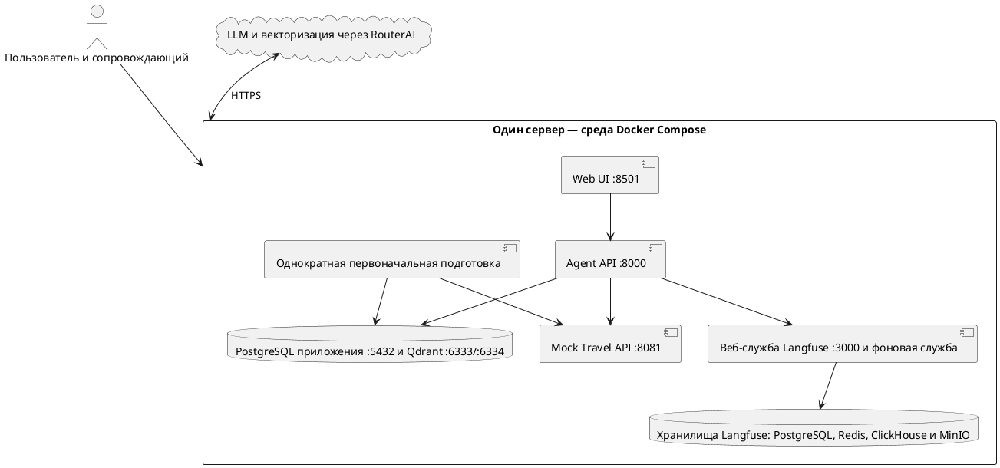
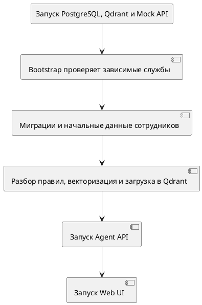
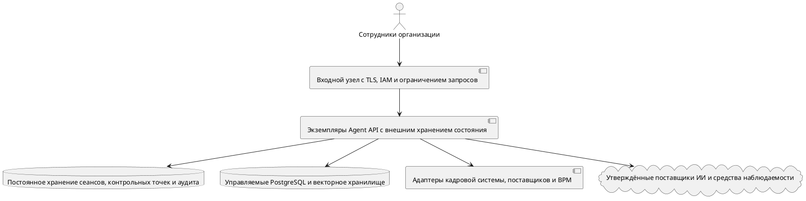

# Развёртывание, эксплуатация и эволюция Travel Policy Copilot

**Проект:** Travel Policy Copilot  
**Целевая инициатива:** Travel AI Platform  
**Тип документа:** архитектура развёртывания и план развития  

---

## 1. Назначение документа

Документ описывает:

- физическую схему локального развёртывания с помощью Docker Compose;
- службы, порты, сети, тома данных и внешние зависимости;
- порядок запуска, первоначальную подготовку, миграции, начальные данные и индексацию корпуса документов для RAG;
- проверки работоспособности и готовности, поведение при отказах и восстановление;
- порядок безопасной эксплуатации;
- границы резервного копирования и восстановления, жизненный цикл данных;
- эксплуатацию компонентов ИИ: версии моделей, запросов к модели, конфигурации, корпуса и индекса;
- допущения о нагрузке и план их измерения;
- переход от учебного MVP к пилотной эксплуатации и направление промышленного развития.

Документ дополняет:

- `03-container-architecture.md` — логические контейнерные границы;
- `04-agent-component-architecture.md` — внутреннюю структуру Agent API;
- `05-dynamic-architecture.md` — последовательности взаимодействий при выполнении;
- `06-data-and-rag-architecture.md` — хранилища, жизненный цикл и загрузку данных;
- `07-api-and-tool-contracts.md` — проверки работоспособности и готовности, а также контракты интеграции;
- `08-security-architecture.md` — сеть, секреты и границы доверия;
- `09-quality-and-observability.md` — быстрые проверки, критерии качества и сведения о выполнении.

Диаграмма C2 показывает логические контейнеры системы. Настоящий документ уточняет, где и в каких исполняемых единицах они запускаются.

---

## 2. Принципы развёртывания

1. Учебный MVP разворачивается на одном доверенном компьютере разработчика или демонстрационном сервере.
2. Docker Compose определяет способ развёртывания; ответственность систем за данные сохраняется.
3. База данных приложения в PostgreSQL отделена от внутренней базы данных Langfuse.
4. Qdrant хранит индекс, который можно перестроить; исходные документы хранятся отдельно.
5. Служба Bootstrap выполняет первоначальную подготовку; API и интерфейс становятся готовыми только после её успешного завершения.
6. В режиме `strict` обязательные хранилища и сервис векторизации нельзя незаметно заменять резервными реализациями.
7. Отказ Langfuse не прерывает основную операцию.
8. Сеансы, контрольные точки и временные события аудита хранятся в памяти Agent API и теряются при его перезапуске.
9. Локальные учётные данные и опубликованные порты допустимы только в изолированной среде MVP.

---

## 3. Диаграмма развёртывания в текущей реализации



Диаграмма показывает размещение служб на одном сервере; бизнес-границы систем описаны отдельно. Mock Travel API и Langfuse остаются логически внешними либо вспомогательными системами.

---

## 4. Каталог исполняемых сервисов

| Служба                              | Образ или сборка                         | Порт сервера   | Роль                                                        |
| ----------------------------------- | ---------------------------------------- | -------------- | ----------------------------------------------------------- |
| Web UI                              | Локальная сборка на Python 3.12          | `8501`         | Демонстрационный интерфейс Streamlit                        |
| Agent API                           | Локальная сборка                         | `8000`         | API с состоянием, LangGraph и инструменты                   |
| Bootstrap                           | Локальная сборка                         | Нет            | Миграции, начальные профили сотрудников и индексация правил |
| База данных приложения в PostgreSQL | `postgres:17`                            | `5432`         | Профили и черновики заявок                                  |
| Qdrant                              | `qdrant/qdrant:latest`                   | `6333`, `6334` | Векторы правил и метаданные                                 |
| Mock Travel API                     | Локальная сборка                         | `8081`         | Синтетический каталог предложений и имитация ошибок         |
| Веб-служба Langfuse                 | Langfuse `:4`                            | `3000`         | Интерфейс и API трассировки                                 |
| Фоновая служба Langfuse             | Langfuse `:4`                            | `3030`         | Фоновая обработка данных наблюдения                         |
| Langfuse PostgreSQL                 | `postgres:17`                            |                | Реляционные метаданные Langfuse                             |
| Redis                               | `redis:7`                                |                | Очередь и кэш Langfuse                                      |
| ClickHouse                          | `clickhouse:25.12`                       |                | Аналитические события Langfuse                              |
| MinIO                               | Образ Chainguard без закреплённой версии |                | Объектное хранилище Langfuse                                |


---

## 5. Сеть и внешняя доступность

### 5.1. Текущее состояние

| Интерфейс                         | Назначение                            | Допустимая доступность в MVP                                                 |
| --------------------------------- | ------------------------------------- | ---------------------------------------------------------------------------- |
| UI `8501`                         | Доступ к демонстрационному интерфейсу | Только локально или с демонстрационного сервера                              |
| API `8000`                        | Запросы интерфейса и документация API | Только локально или с демонстрационного сервера                              |
| Mock API `8081`                   | Интеграция агента и отладка           | Внутри сети Docker Compose; публикация порта сервера — только при разработке |
| База данных приложения `5432`     | Хранение прикладных данных            | Внутри сети Docker Compose; доступ с сервера — только администратору         |
| Qdrant `6333/6334`                | Векторное хранилище                   | Внутри сети Docker Compose; доступ с сервера — только при разработке         |
| Langfuse `3000`                   | Просмотр трассировок                  | Только доверенному оператору                                                 |
| MinIO и вспомогательные хранилища | Внутренние компоненты Langfuse        | Только внутри сети или через `localhost`                                     |
| API, совместимый с RouterAI       | LLM и векторизация                    | Только исходящие соединения HTTPS                                            |

### 5.2. Целевое состояние для пилотной эксплуатации

- для внешнего доступа публикуются только входной узел с TLS, шлюз API и, при необходимости, UI;
- PostgreSQL, Qdrant, хранилище сеансов, журнал аудита и Langfuse остаются во внутренней сети;
- личность пользователя подтверждается через OIDC/SSO;
- исходящие соединения разрешены только с утверждёнными интерфейсами LLM, векторизации и поставщиков услуг;
- CORS, ограничения частоты запросов и размеров запроса и ответа заданы явно;
- секреты предоставляются через механизм идентификации службы и систему управления секретами, а не через локальный файл `.env`;
- административные интерфейсы доступны только по защищённому каналу оператора.

---

## 6. Тома хранения и состояние

| Данные или состояние                                | Текущее место хранения                         | Сохранность при перезапуске контейнера | Первичный источник                                              | Приоритет резервного копирования                        |
| --------------------------------------------------- | ---------------------------------------------- | -------------------------------------: | --------------------------------------------------------------- | ------------------------------------------------------- |
| Профили сотрудников                                 | Том базы данных приложения в PostgreSQL        |                                     Да | PostgreSQL приложения или начальный набор данных для MVP        | Высокий                                                 |
| Черновики заявок                                    | Том базы данных приложения в PostgreSQL        |                                     Да | PostgreSQL приложения                                           | Критический                                             |
| Векторы и фрагменты правил                          | Том Qdrant                                     |                                     Да | Производные данные; восстанавливаются из корпуса и конфигурации | Средний                                                 |
| Корпус правил                                       | Файлы репозитория или содержимое образа        | Да при сохранности исходных документов | Корпус документов Markdown                                      | Высокий                                                 |
| Записи сеансов                                      | Память Agent API                               |                                    Нет | Память процесса                                                 | Не подлежит резервному копированию в текущей реализации |
| Контрольные точки LangGraph                         | Agent API `InMemorySaver`                      |                                    Нет | Память процесса                                                 | Не подлежит резервному копированию в текущей реализации |
| Временные события аудита                            | Память AgentState                              |                                    Нет | Память процесса                                                 | Не отвечает требованиям к журналу аудита                |
| Реляционные данные Langfuse                         | Том PostgreSQL для Langfuse                    |                                     Да | Langfuse                                                        | По правилам хранения                                    |
| События и аналитические данные трассировки          | Том ClickHouse                                 |                                     Да | Langfuse                                                        | По требованиям к доказательствам и правилам хранения    |
| Объекты Langfuse                                    | Том MinIO                                      |                                     Да | Langfuse                                                        | По требованиям к доказательствам и правилам хранения    |
| Данные Redis                                        | Контейнер Redis; наличие тома требует проверки |                              Проверить | Вспомогательное состояние                                       | Обычно восстанавливается из других источников           |
| Отчёты о сравнительных испытаниях и оценке качества | Файлы рабочей среды или репозитория            |   Зависит от сохранности рабочей среды | Подтверждение качества                                          | Высокий для контрольного запуска                        |


---

## 7. Конфигурация и режимы внутренних систем

### 7.1. Основные группы

| Группа | Значения и поведение в текущей реализации | Эксплуатационное замечание |
|---|---|---|
| Режим внутренних систем | `strict`; также `demo_fallback`, `test` | Режим должен отражаться в ответах о работоспособности, отчётах и трассировках |
| LLM | Поставщик с интерфейсом, совместимым с RouterAI; `gpt-4o-mini` | 20 с; две повторные попытки; не более 800 токенов; температура 0,1 |
| Векторизация | Поставщик с интерфейсом, совместимым с RouterAI; `baai/bge-m3`, размерность 1024 | 8 с; без повторных попыток; модель влияет на имя коллекции |
| PostgreSQL | Локальный DSN по умолчанию | Проверка структуры DSN ограничена; учётные данные передаются через переменные среды |
| Qdrant | Базовая коллекция `travel_policy_chunks` | Имя содержит нормализованное обозначение модели и `v1` |
| Travel API | Локальный URL или служба Docker Compose | 8 с; клиент не выполняет скрытых повторных запросов |
| Langfuse | Локальный адрес развёрнутого Langfuse; без ключей отключён | Ошибки не прерывают основной сценарий; отсутствие учётных данных должно быть явно видно |
| Ограничения запроса | По умолчанию 4000 символов и 12 переходов графа | Фактическое поведение и настройки должны соответствовать контракту API |
| Поиск | Фрагмент 800 символов; перекрытие 150; `top-k` 12; `top-n` 5; контекст 2400 символов | Изменение требует проверки качества RAG и необходимости переиндексации |

### 7.2. Секреты

Необходимо указать `LLM_API_KEY`, `EMBEDDING_API_KEY`, `LANGFUSE_PUBLIC_KEY`, `LANGFUSE_SECRET_KEY`. Значения секретов нельзя сохранять в Git, отчётах, журналах, снимках экрана и архитектурном репозитории.

Файл `.env.example` служит только шаблоном.

### 7.3. Смысл режимов работы

| Зависимость | `strict` | `demo_fallback` / `test` |
|---|---|---|
| Чтение профиля и запись в PostgreSQL | Обязателен; при недоступности возвращается управляемая ошибка | Для профиля и согласования может быть разрешён резервный механизм в памяти |
| Qdrant | Обязателен для RAG | Допустим локально созданный индекс |
| Векторизация | Требуется внешний сервис | Допустима векторизация на основе хешей |
| Mock Travel API | Требуется интеграция по HTTP | В зависимости от состава компонентов допускается тестовая реализация |
| Формулирование ответа и разбор запроса с помощью LLM | При ошибке поставщика может сработать детерминированный резервный механизм приложения | Допустим аналогичный резервный механизм |
| Langfuse | Необязателен; ошибка не прерывает основной сценарий | Необязателен; ошибка не прерывает основной сценарий |

Режим `strict` запрещает скрытую подмену обязательных хранилищ и сервиса векторизации. При этом для некритичных функций LLM допустим предусмотренный кодом детерминированный резервный механизм. Работа в ограниченном режиме должна отражаться в ответе, трассировке и отчёте.

---

## 8. Модель зависимостей при запуске



### 8.1. Ограничение проверки готовности

- Для базы данных приложения в PostgreSQL настроена проверка работоспособности средствами Docker Compose.
- Для Qdrant и Mock API зависимость при запуске задаётся условием `service_started`, которое не подтверждает готовность службы.
- Bootstrap самостоятельно проверяет доступность PostgreSQL, Qdrant и HTTP-интерфейса Mock API и завершается с ошибкой, если они недоступны.
- Индексация в режиме `strict` требует доступного сервиса векторизации; его доступность проверяется при обращении.
- API запускается после успешной работы Bootstrap.
- UI зависит от Bootstrap и API.
- В режиме `strict` маршрут Agent API `/ready` проверяет PostgreSQL, Qdrant и Mock API.


---

## 9. Правила первоначальной подготовки

### 9.1. Шаги в текущей реализации

1. дождаться обязательных локальных служб;
2. применить файлы `migrations/*.sql` с учётом выполненных миграций в `schema_migrations`;
3. добавить или обновить синтетические данные сотрудников из начального набора JSON;
4. прочитать документы Markdown из корпуса правил поездок;
5. разобрать и нормализовать документы, разделить их на фрагменты и дополнить метаданными;
6. получить векторные представления фрагментов;
7. удалить и заново создать целевую коллекцию Qdrant;
8. добавить или обновить векторы и связанные данные;
9. завершиться успешно только после обязательной подготовки.

### 9.2. Повторяемость

| Операция | Поведение по исходному коду | Риск |
|---|---|---|
| Миграции | Реестр предотвращает повторное применение | Проверить поведение при частично выполненной миграции и границы транзакции |
| Начальные данные сотрудников | Добавление или обновление записей | Проверить правила перезаписи и сохранность изменений, внесённых вручную |
| Индексация в Qdrant | Удаление и повторное создание коллекции | Временная недоступность и отсутствие атомарного отката |
| Идентификаторы записей | Воспроизводимый UUID5 на основе идентификатора раздела | Стабильно при неизменных исходных данных и правилах разбиения |
| Создаваемый локальный индекс | Также создаётся при первоначальной подготовке | Назначение и порядок очистки требуют проверки |

Повторная первоначальная подготовка описана как воспроизводимая, но её повторный запуск на чистой среде ещё не проверен.

### 9.3. Целевая загрузка и индексация

При пилотной эксплуатации обновление индекса не должно сопровождаться удалением действующей коллекции. Рекомендуется:

- создать новую коллекцию с номером версии;
- загрузить данные и проверить число записей, схему и контрольную сумму;
- проверить качество RAG на эталонном наборе;
- атомарно переключить псевдоним коллекции или конфигурацию чтения;
- сохранить предыдущую версию для отката;
- удалить старую версию только в соответствии с правилами хранения.

---

## 10. Подготовка и запуск

### 10.1. Предварительные условия

- Docker Engine и плагин Docker Compose;
- доступ к реестру образов контейнеров и к внешним LLM;
- свободные порты сервера;
- достаточное место для томов приложения и Langfuse;
- защищённые учётные данные для API и Langfuse;
- корпус правил поездок и набор синтетических данных сотрудников.

### 10.2. Предварительная проверка

1. проверить, что секретов нет в исходном коде и истории репозитория;
2. создать `.env` из `.env.example` и заполнить только локально;
3. проверить итоговую конфигурацию Docker Compose, не раскрывая секреты;
4. убедиться, что порты свободны и не доступны из недоверенной сети;
5. проверить свободное место и имеющиеся тома.

### 10.3. Рекомендуемый запуск текущей реализации

Команда, приведённая в README:

```bash
docker compose up -d --build
```

---

## 11. Модель пропускной способности

### 11.1. Известные границы

| Параметр | Текущее значение |
|---|---:|
| Входное сообщение | По умолчанию не более 4000 символов |
| Переходы графа | По умолчанию не более 12 |
| LLM: время ожидания и повторные попытки | 20 с / 2 |
| Векторизация: время ожидания и повторные попытки | 8 с / 0 |
| Travel API: время ожидания и повторные попытки | 8 с / без скрытого повторения |
| Размер пакета при векторизации | 32 |
| Размерность вектора | 1024 |
| Предельное число кандидатов из Qdrant | 48 |
| Параметры отбора приложения `top-k` / `top-n` | 12 / 5 |
| Ограничение контекста | 5 фрагментов / 2400 символов |
| Задержка p50/p95 по опубликованным испытаниям | 6349 / 8113 мс; измерения относятся к другой исходной версии с незакреплёнными изменениями |

### 11.2. Неопределённые параметры нагрузки

- число активных пользователей и одновременно работающих пользователей;
- число запросов и действий за сеанс;
- частота поступления запросов и превышение нагрузки в пиковые периоды;
- число документов и фрагментов корпуса, скорость его роста;
- рост числа черновиков заявок и срок их хранения;
- объём трассировок, размер записей и сроки их хранения;
- число запросов и токенов у поставщика, ограничения частоты обращений;
- размер пула соединений PostgreSQL и число одновременных запросов к Qdrant;
- ресурсы сервера: CPU, оперативная память, диск и производительность операций ввода-вывода (IOPS);
- время, отведённое на резервное копирование, и скорость восстановления.

### 11.3. Узкие места текущей реализации

| Компонент | Ограничение |
|---|---|
| Agent API | Хранение сеансов в памяти процесса препятствует горизонтальному масштабированию |
| Внешняя LLM | Задержка, квоты и стоимость; собственные GPU приложение не использует |
| Сервис векторизации | Скорость первоначальной подготовки и переиндексации ограничена пропускной способностью и квотами поставщика |
| PostgreSQL | Пул соединений, скорость записи и объём хранения; потребность в ресурсах не измерена |
| Qdrant | Число векторов, память, диск и задержка поиска; образ не закреплён неизменяемой версией |
| Bootstrap | Последовательные зависимости при запуске и удаление действующей коллекции при переиндексации |
| Службы Langfuse | Несколько локальных хранилищ, потребляющих место на диске и ресурсы CPU |
| Один сервер | Общая точка отказа и конкуренция за ресурсы |

### 11.4. План проверки пропускной способности

1. измерить потребление ресурсов всеми службами Docker Compose без нагрузки;
2. измерить длительность первоначальной подготовки на чистой среде, пиковое потребление памяти и CPU, а также обращения к поставщику;
3. несколько раз выполнить сравнительное испытание на фиксированном наборе данных;
4. постепенно увеличивать число одновременных сеансов;
5. отдельно измерить работу API, LLM, инструментов, Qdrant, PostgreSQL и Langfuse;
6. проверить ограничения поставщика по частоте запросов и управляемое ограничение входной нагрузки;
7. измерить рост объёма трассировок и данных на диске;
8. проверить перезапуск и восстановление после накопления данных;
9. определить предел пропускной способности и резерв ресурсов;
10. утвердить SLO и требования к ресурсам для пилотной эксплуатации по результатам измерений.

Для внешней управляемой LLM расчёт потребности в GPU на своей стороне не требуется. Вместо этого оценивают одновременную нагрузку на API, квоты внешних поставщиков, ресурсы хранилищ и средства наблюдаемости.

---

## 12. Развитие архитектуры

### 12.1. Сравнение уровней

| Область | Текущее состояние учебного MVP | Целевое состояние для пилотной эксплуатации | Направление промышленного развития |
|---|---|---|---|
| Среда выполнения | Docker Compose на одном сервере | Управляемая среда контейнеров; при необходимости несколько экземпляров API | Развёртывание в нескольких зонах и автоматическое масштабирование по SLO |
| Внешний доступ к UI и API | Прямое подключение к локальным портам | Входной узел с TLS и шлюз API | Отказоустойчивый входной узел, WAF и ограничения частоты запросов по потребности |
| Идентификация | Клиент передаёт идентификатор сотрудника | OIDC/SSO, сопоставление учётной записи с сотрудником и разграничение полномочий | Централизованное управление доступом, жизненным циклом учётных записей и периодические проверки прав |
| Сеансы и контрольные точки | Хранение в памяти | Постоянное хранилище с версиями и ограниченным сроком жизни записей (TTL) | Отказоустойчивое хранилище, разделение данных и планирование ресурсов |
| База данных приложения в PostgreSQL | Локальный контейнер с томом | Управляемая база данных с резервным копированием и восстановлением | Высокая доступность, масштабирование чтения и аварийное восстановление по SLO |
| Qdrant | Одна локальная служба | Управляемое или выделенное векторное хранилище с версионированием коллекций | Высокая доступность, разделение данных и аварийное восстановление при наличии обоснования |
| Предложения, профили и заявки | Имитация внешнего API и локальные хранилища | Адаптеры к поставщикам услуг, кадровой системе и BPM/ERP | Управляемые интеграции с несколькими поставщиками |
| LLM и векторизация | Внешний поставщик | Утверждённый поставщик, квоты, договорённости об обработке данных и правила работы при отказе | Несколько поставщиков при подтверждённой деловой потребности |
| Корпус правил | Документы Markdown в репозитории | Управляемый источник знаний и порядок публикации | Жизненный цикл правил и аудит изменений на уровне организации |
| Наблюдаемость | Langfuse размещён на том же сервере | Управляемый и защищённый Langfuse, журналы, метрики и SIEM | Отказоустойчивые средства наблюдаемости и контроль SLO |
| Аудит | Временные события в памяти | Постоянный журнал с запретом изменения ранее записанных событий | Централизованная платформа аудита и контроля соблюдения требований |
| Секреты | Файл `.env` | Система управления секретами и идентификация служб | Централизованная смена секретов и применение HSM при необходимости |
| Поставка изменений | Ручной запуск Docker Compose | CI/CD, неизменяемые артефакты и критерии качества | Поэтапное развёртывание, пробный выпуск и откат |
| Резервное копирование и аварийное восстановление | Не определены | Проверенные резервные копии и утверждённые RPO/RTO | Восстановление между зонами или регионами при необходимости |

### 12.2. Схема развёртывания для пилотной эксплуатации



Agent API сможет работать в нескольких экземплярах без привязки сеанса к памяти процесса после переноса сеансов и контрольных точек в постоянное хранилище, введения оптимистического контроля версий и долговременного журнала аудита. До этого увеличение числа экземпляров приведёт к несогласованности маршрутизации запросов и состояния.

### 12.3. Использование Kubernetes

Переход на Kubernetes следует обосновать эксплуатационными требованиями. Он может потребоваться, если пилотная или промышленная эксплуатация предполагает несколько экземпляров служб, обновление без простоя, автоматическое масштабирование, изоляцию нагрузок и применение единых правил безопасности, а команда готова сопровождать платформу. При умеренной нагрузке может быть достаточно управляемой среды контейнеров.

---
